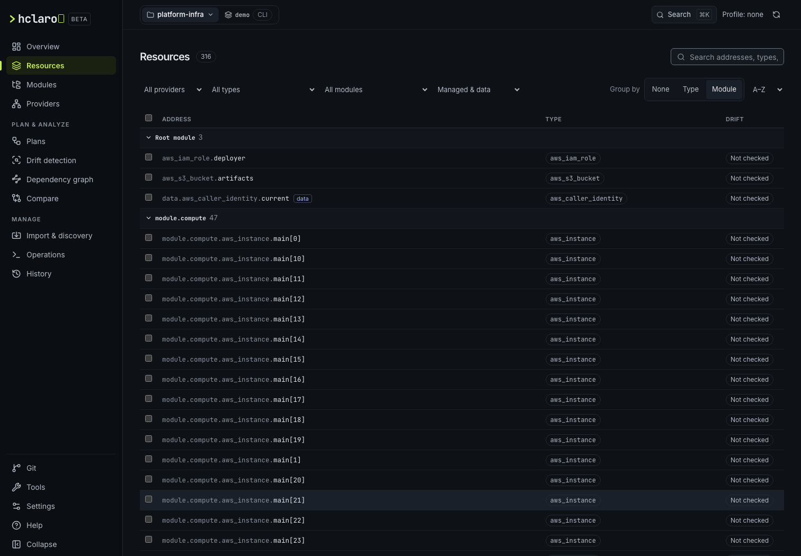

# hclaro

*By [BotOpsy](https://github.com/botopsy).* **A local-first workspace for Terraform and OpenTofu.**

Hclaro is a single binary that starts a private web UI on your own machine for the project you run it in. Browse recorded state, review plans before anything changes, and apply only a reviewed saved plan after an explicit confirmation. No accounts, telemetry, cloud service or external runtime assets.

[Install](#installation) · [Documentation](docs/README.md) · [Getting started](docs/GETTING_STARTED.md) · [Releases](https://github.com/botopsy/hclaro/releases)



## Overview

Terraform and OpenTofu show state and plans as text. Hclaro puts the same information, read through your own installed engine, in a browser UI that is easier to search, filter and review, without sending it anywhere.

- **For** developers and platform engineers who work with several Terraform/OpenTofu projects and workspaces.
- **Why not only the CLI:** a plan with hundreds of changes is hard to read in a terminal. Hclaro lists every change with its attribute diff, shows dependencies and drift, and keeps the confirmation steps for risky operations explicit.
- **Local-first:** Hclaro listens only on `127.0.0.1`, uses the Terraform or OpenTofu CLI you already have, and keeps its own files in your user configuration folder. It runs no command on its own: plans, drift scans, imports and applies happen only when you ask for them in the UI.

Hclaro is free and open source under the [Apache License 2.0](LICENSE), for personal and commercial use.

## Key capabilities

| | |
| --- | --- |
| **Resource Explorer** | Resource instances, nested modules and provider sources from recorded state, with search, filters and an inspector that redacts sensitive attributes. [Guide](docs/guides/resource-explorer.md) |
| **Visual Plan Review** | Every change in a plan with its replacement order, reason and attribute diff; replacement and import through the same reviewed plan. [Guide](docs/guides/plans-and-apply.md) |
| **Safe Operations** | Apply only a reviewed saved plan, after preflight checks and a typed confirmation, for locally executed backends. Never `destroy`, `state rm/mv` or `force-unlock`. [Guide](docs/guides/plans-and-apply.md#apply) |
| **Workspace Hub** | Several project roots and CLI workspaces in one place, guided `init`, workspace lifecycle and read-only project tools. [Guide](docs/guides/workspace-hub.md) |
| **Infrastructure Analysis** | Drift detection (refresh-only, never writes state), dependency graph with potential impact, and comparison of two workspaces. [Drift](docs/guides/drift-detection.md), [graph](docs/guides/dependency-graph.md), [compare](docs/guides/workspace-comparison.md) |
| **Developer Tools** | Execution profiles, operation history, Git status, diffs and branch switching, plus opt-in read-only cloud discovery (AWS, Google Cloud, Azure), Infracost estimates and AI review. [Profiles](docs/guides/execution-profiles.md), [history and Git](docs/guides/history-and-git.md) |

Cost estimates and AI assistance send data to third parties only when you opt in; `hclaro --strict-local` disables them.

## Installation

Release archives exist for macOS arm64/amd64, Linux amd64/arm64 and Windows amd64. You also need Terraform 1.5–1.17 or OpenTofu 1.6–1.13 on `PATH`; Hclaro never downloads an engine.

```sh
# macOS and Linux (Windows: run from Git Bash). Checks the archive's sha256 before installing.
curl -fsSL https://get.hclaro.dev | sh

# macOS with Homebrew (Linux untested)
brew install botopsy/tap/hclaro
```

Or download an archive and the checksums file from [GitHub Releases](https://github.com/botopsy/hclaro/releases), or build from source with Go 1.26+ and Make (`make binary` produces `bin/hclaro` without Node). Binaries are not code-signed or notarized, so Gatekeeper and SmartScreen warn on first launch. Verification, upgrade and uninstall: [Getting started](docs/GETTING_STARTED.md#2-install).

## Quick start

```sh
hclaro --version                       # check the install
cd path/to/terraform-root && hclaro    # open one project
hclaro --hub                           # or open the Workspace Hub and register several
```

Open the private URL printed in the terminal. It contains the session credential: do not share it or paste it anywhere.

To look around without real infrastructure, a source checkout has a synthetic demo that uses a fake engine and contacts nothing (it is not part of release binaries, and it is not evidence that a real engine or provider works):

```sh
make demo-hub   # Workspace Hub with synthetic projects
make demo       # one synthetic project with 316 resources
```

The full walkthrough, from first project to a reviewed apply, is in [Getting started](docs/GETTING_STARTED.md).

## Documentation

The [documentation index](docs/README.md) describes every page. The main entries:

| Section | Contents |
| --- | --- |
| [Getting started](docs/GETTING_STARTED.md) | Install, demo, first project, upgrade, uninstall. |
| [User guides](docs/README.md#user-guides) | One guide per feature. |
| [Command line](docs/reference/cli.md) and [troubleshooting](docs/reference/troubleshooting.md) | Flags, exit codes, common problems. |
| [Compatibility](docs/reference/compatibility.md) and [support matrix](docs/support-matrix.md) | Supported engine versions and what has been run for real. |
| [Architecture](docs/architecture.md) and [security model](SECURITY.md) | How Hclaro works and what it protects. |
| [Building and testing](docs/development/building-and-testing.md) | Developing Hclaro. |

## Status and safety

Hclaro is **not production-certified**. Read [Status, testing and limitations](docs/reference/limitations.md) before pointing it at infrastructure you care about.

- It is tested with synthetic fixtures and fake engines in CI. Terraform 1.5.5, 1.5.7 and 1.17.2 and OpenTofu 1.6.3 and 1.13.9 have also been run end to end against disposable projects with the local backend only. No cloud provider or remote backend is certified.
- Release binaries are not code-signed or notarized. Checksums and build-provenance attestations (`gh attestation verify <file> -R botopsy/hclaro`) are published with each release.
- Reading state runs your engine, which may contact the configured backend and load provider plugins with your credentials.
- Operations that can change infrastructure need explicit user action, and plans and applies are limited to locally executed backends.
- Secrets are redacted on the server before data reaches the browser. Redaction relies on markers and heuristics and can miss a secret; one hidden value can be revealed on request.
- Start with non-production projects. An apply changes real infrastructure and cannot be undone by Hclaro.

## Community

- Bugs and feature requests: [GitHub Issues](https://github.com/botopsy/hclaro/issues). Questions and ideas: [GitHub Discussions](https://github.com/botopsy/hclaro/discussions).
- [Contributing](CONTRIBUTING.md), [code of conduct](CODE_OF_CONDUCT.md), [security policy](SECURITY.md) (report vulnerabilities privately) and [license](LICENSE).
- **Never attach** state, plans, variable files, credentials, the private session URL or real account identifiers to an issue.

Hclaro is licensed under the [Apache License, Version 2.0](LICENSE): you may use, modify, fork and redistribute it, including commercially. Bundled third-party components keep their own licenses ([`THIRD-PARTY-NOTICES.txt`](internal/ui/dist/THIRD-PARTY-NOTICES.txt)). The license grants no trademark rights; see [TRADEMARKS.md](TRADEMARKS.md). Copyright 2026 BotOpsy. BotOpsy is an independent software brand and the publishing name of Hclaro's author, not a company or a separate legal entity.
