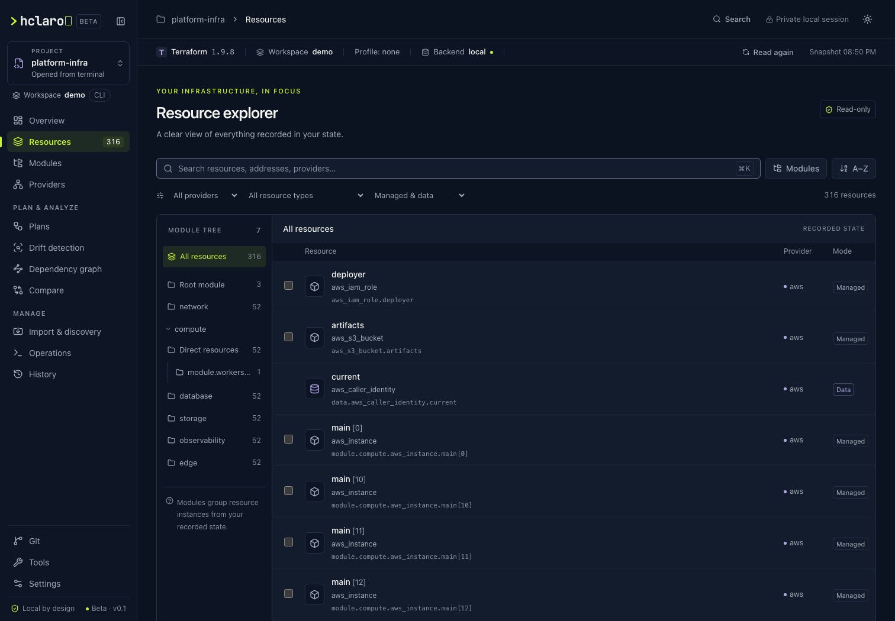

# hclaro

*By [BotOpsy](https://github.com/botopsy).* **A local-first workspace for Terraform and OpenTofu.** Hclaro is a single binary that starts a private web UI on your own machine (`127.0.0.1`) for the project you run it in. Browse recorded state, review plans before anything changes, and apply only a reviewed saved plan after an explicit confirmation. No accounts, telemetry, cloud service or external runtime assets.

> **Public beta, not production-certified.** Hclaro is free and open source under the [Apache License 2.0](LICENSE), for personal and commercial use. It is tested with synthetic fixtures and fake engines in CI; real Terraform has been exercised only against a disposable local project, and no cloud provider, remote backend or OpenTofu release is certified yet. Read [docs/BETA.md](docs/BETA.md) before pointing it at infrastructure you care about.



## What it does

| Area | What you get |
| --- | --- |
| **Explore** | Resource instances, nested modules and provider sources from recorded state; search, filters, an inspector with redacted attributes, and an overview. |
| **Plan & analyze** | Plans with a visual review of every change; drift detection (refresh-only, never writes state); dependency graph and blast radius; comparison of two workspaces. |
| **Change, with confirmation** | Replace selected instances and import existing objects through reviewed plans; apply only a reviewed saved plan, after preflight checks and a typed confirmation, for locally executed backends. |
| **Manage** | Workspace Hub for several project roots, guided `init`, CLI workspace lifecycle, read-only project tools (`validate`, `fmt -check`, `providers`, output metadata), execution profiles, operation history and a Git view. |
| **Optional, opt-in** | Read-only AWS cloud discovery through your AWS CLI; cost estimates through a local Infracost CLI (off by default; disabled by `--strict-local`). |

Hclaro never runs `init`, `plan`, `refresh` or `apply` on its own, never runs `destroy`, `state rm/mv` or `force-unlock`, and redacts secrets on the server before data reaches the browser. Details: [SECURITY.md](SECURITY.md) and [docs/architecture.md](docs/architecture.md).

## Install

**Beta binaries.** Pre-releases are published on [GitHub Releases](https://github.com/botopsy/hclaro/releases) as `hclaro_<version>_<os>_<arch>` archives for macOS (arm64, amd64), Linux (amd64, arm64) and Windows (amd64), with a SHA-256 checksums file. Binaries are not signed or notarized, so macOS Gatekeeper and Windows SmartScreen warn on first launch. macOS arm64, Linux amd64 and Windows amd64 packages are smoke-tested natively in CI; Linux arm64 and macOS amd64 are cross-compiled only.

```sh
shasum -a 256 -c hclaro_<version>_checksums.txt --ignore-missing
```

**From source:** Go 1.26+ and Make (see [Build from source](#build-from-source)); `make binary` produces `bin/hclaro` from the committed UI bundle without Node.

You also need Terraform (1.5–1.17) or OpenTofu (1.6–1.13) on `PATH` and an initialized project. Step-by-step instructions, troubleshooting and uninstall: [docs/GETTING_STARTED.md](docs/GETTING_STARTED.md).

## Quick start

```sh
cd path/to/terraform-root
hclaro                 # opens the project in your browser (read-only until you act)
hclaro --hub           # Workspace Hub with your registered projects
hclaro --strict-local  # disable every feature that sends data to a third party
```

## License and feedback

Hclaro is licensed under the [Apache License, Version 2.0](LICENSE). You may use it, including commercially, modify it, fork it and redistribute it under that license. Bundled third-party components keep their own licenses; see [`internal/ui/dist/THIRD-PARTY-NOTICES.txt`](internal/ui/dist/THIRD-PARTY-NOTICES.txt). The license grants no trademark rights; see [TRADEMARKS.md](TRADEMARKS.md) for how to refer to the hclaro and BotOpsy names and logos.

```text
Copyright 2026 BotOpsy
Licensed under the Apache License, Version 2.0
```

hclaro is published by BotOpsy, an independent software brand and the publishing name of hclaro's author. BotOpsy is not a company or a separate legal entity.

Bug reports and feature requests are welcome as [GitHub Issues](https://github.com/botopsy/hclaro/issues); questions and ideas in [GitHub Discussions](https://github.com/botopsy/hclaro/discussions). During the beta the project does not accept external pull requests; see [CONTRIBUTING.md](CONTRIBUTING.md). Report vulnerabilities privately as described in [SECURITY.md](SECURITY.md). **Never attach state, plans, variable files, credentials or real account identifiers.**

The sections below are the detailed reference.

## Run the isolated demo

Go 1.26 or newer and Make are sufficient; the frontend is already built and embedded:

```sh
make demo
```

Open the private session URL printed in the terminal. This builds a fake CLI in `bin/mock`, selects it explicitly, and uses only the synthetic project, backend metadata, and 316-resource fixture. It never runs an installed Terraform/OpenTofu executable. Operation history from the demo is kept in `.cache/demo/config`, not in your real configuration folder. Ctrl+C stops the server. Your environment must permit local TCP listeners and a browser.

Do not install the fake executable on your normal PATH.

```sh
make demo-hub
```

opens the Workspace Hub with three synthetic projects: a Terraform project with `default`, `dev` and `prod` workspaces, an OpenTofu project and an uninitialized one, plus two comparison roots (`stack` with `dev` and `prod`, and `stack-tofu`, the same stack recorded by OpenTofu, whose `default` workspace has a renamed module) for **Compare workspaces**. They and their registry live in `.cache/hub-demo`; your real registry is not used.

## Build from source

Build prerequisites: Go 1.26+, Node.js 22.12+ (Node 24 recommended), npm, and Make. Node is a **build tool only**. Go race tests also require a C compiler.

```sh
make install     # install frontend dependencies; requires npm registry access
make build       # TypeScript + Vite, then embed assets into bin/hclaro
make test        # Go race tests + Vitest
make lint        # go vet + TypeScript + ESLint
```

`make install` runs `npm ci` against the committed `web/package-lock.json`. Update dependencies deliberately with `npm install --prefix web <pkg>@<version>` and commit the lockfile change.

`make binary` builds from the already bundled assets without Node. It uses `CGO_ENABLED=0`, `-trimpath`, `-buildvcs=false`, and a fixed version; rebuilding with the same Go toolchain, target, version, and assets produces the same binary bytes. `make build` regenerates the embedded assets; Vite output is deterministic for the same lockfile, so rebuilding unchanged sources produces identical files.

## Use with an existing project

```sh
./bin/hclaro
./bin/hclaro --path ./infrastructure/prod
./bin/hclaro --port 8080
./bin/hclaro --engine terraform
./bin/hclaro --engine tofu
./bin/hclaro --no-browser
./bin/hclaro --help
./bin/hclaro --version
```

Hclaro inspects only the selected directory; it never searches parent directories. Terraform is preferred when both CLIs are on PATH. The port is dynamically allocated unless supplied. The browser opens automatically; if it does not, use the printed URL. Exit codes: 0 success/help/version, 1 startup failure, 2 invalid arguments.

Launch runs only `version -json`, `workspace show`, and `show -json`. It never runs init (init runs only from a Hub project page after you confirm it; see [Initialize a project](#initialize-a-project)), plan, refresh, apply, destroy, import, replace, or state modifications. A plan runs only when you confirm it in the UI (see [Plans](#plans)). Hclaro never runs `terraform import`/`tofu import`; imports use import blocks and a reviewed plan (see [Import](#import)). Reading state can contact the configured remote backend and load installed provider plugins. Use an initialized project and your existing credentials/environment; Hclaro does not resolve or store credentials itself.

The UI displays **one recorded snapshot**, not live provider inventory or drift detection. Browsing, searching, filtering, sorting, and opening details read process memory. Use **Read again** in the context bar (or restart Hclaro) to inspect the folder and reread state after an external change, such as running `init` in a terminal; it runs no init, plan or refresh and is unavailable while an operation runs. Inherited `TF_CLI_ARGS` settings are accepted only when they contain `-no-color`; other injected flags fail explicitly because they can redirect raw output or alter reads. `TF_DATA_DIR`, `TF_WORKSPACE`, CLI configuration, and credential settings are inherited. `TF_LOG*` and update checks are disabled for child reads to prevent secret-bearing log files and update telemetry.

The private URL contains a random launch credential in its **fragment**, which is removed by the app before API use. Keep that URL private. The browser stores the credential in sessionStorage for reloads; state is never placed in localStorage. Only display preferences (theme, density, grouping, editor, sidebar mode) and the details-drawer width use localStorage. A stopped/restarted server requires its new URL.

## Workspace Hub

```sh
./bin/hclaro --hub                 # open the Hub; the current directory is not read
./bin/hclaro                       # inside a project: open it, as before; elsewhere: open the Hub
./bin/hclaro --hub --path ./prod   # open the Hub with ./prod as the launch project
```

The **project switcher** at the top of the sidebar shows the current project and how it was opened, and offers the project opened from the terminal, recent Hub projects and **All projects**, which lists registered project roots. A project is one root folder plus an engine choice and a name; a CLI workspace is a state namespace inside it. The two are never treated as the same thing, and neither is a cloud account or profile.

- **Add project** takes an absolute path or a folder picked with **Browse…**, which lists one folder's subfolders at a time (hidden folders skipped, never recursive). The path is resolved through symlinks and must contain `.tf`, `.tofu` or state files; the same folder cannot be added twice, including through a symlink. Names may repeat.
- Rename, pin, reorder (arrow buttons) and **Remove** a project. Removing forgets the entry only; no file, data directory, state or backend is touched. A moved or deleted folder stays listed with its problem and a **Repair path** action.
- The registry is `projects.json` (schema `version: 1`) in your user configuration directory (`~/Library/Application Support/hclaro` on macOS, `~/.config/hclaro` on Linux, `%AppData%\hclaro` on Windows; `HCLARO_CONFIG_DIR` overrides it). It holds IDs, paths, names, engine choice, pins and last-opened time, nothing else. Writes are atomic. A file that cannot be decoded is moved aside to `projects.json.corrupt-<time>` and the Hub starts empty; a file from a newer Hclaro or one that cannot be read is left untouched and the Hub becomes read-only.
- Project cards use the file system only: status, initialization, backend type and lockfile. Engine version and workspaces appear once a project has been opened in the session.

Opening a project runs `version -json` and `workspace list` (no `TF_WORKSPACE`, so the marked workspace is the persisted **CLI default**). Opening a workspace reads its recorded state with `version -json`, `workspace list`, `workspace show` and `show -json`, each child getting `TF_WORKSPACE=<workspace>` in its own environment. Hclaro's own environment is not changed and `workspace select` never runs, so your terminal's workspace stays as it was. The engine must report the selected workspace back before anything is shown. Each tab holds its own project and workspace in the URL (`/projects/<id>/workspaces/<name>/resources`); **New tab** opens the same view in another tab, so `dev` and `prod` can be side by side. **Read again** rereads the state. Search, recently opened projects, arrow-key lists and a production-like-name hint (by name only, never a guarantee) are available.

Hub workspaces are **read-only**: plans, applies and imports remain available only for the project Hclaro was launched with, in its CLI-selected workspace. The writes a Hub project offers are a reviewed init and reviewed workspace commands (below); its read-only **Project tools** run validate, a format check, providers and output metadata on request. With an inherited `TF_WORKSPACE`, the launch project keeps using it while Hub children replace it. An absolute `TF_DATA_DIR` would make every project share one data directory, so Hub reads are refused until Hclaro is restarted without it (a relative `TF_DATA_DIR` resolves inside each project).

### Initialize a project

A project page offers **Initialize…** (or **Run init again…** once initialized). Nothing initializes when a project is added, listed, opened or refreshed.

1. The review reads only the folder, without running the engine: canonical path, engine (and version, if the project was already inspected), backend (initialized type, or whether a `backend`/`cloud` block is declared), workspace (the CLI default; an inherited `TF_WORKSPACE` is not passed to init), data directory, lock file status, the exact command and what init writes and contacts. Inherited settings that change init, such as a CLI configuration file or `TF_PLUGIN_CACHE_DIR`, are named without their values.
2. You tick the acknowledgement and click **Initialize**. The command is always `terraform init -input=false -no-color` / `tofu init -input=false -no-color`; Terraform 1.9 and later run `init -input=false -json` instead so progress is machine-readable. No other flag is ever added: no `-upgrade`, `-migrate-state`, `-force-copy`, `-reconfigure`, `-lock=false`, `-backend=false` or `-backend-config`. Inherited `TF_CLI_ARGS`/`TF_CLI_ARGS_init` with anything but `-no-color` makes init unavailable.
3. The sanitized log streams in the dialog, with a **Cancel init** button. Closing the dialog does not stop init; reopening the page shows its progress. While init runs, that project's workspaces cannot be listed or read and no other operation can run in the same folder; other projects are unaffected.
4. The result shows the status (`succeeded`, `failed`, `cancelled` or `unknown`), the engine exit code, whether `.terraform.lock.hcl` was created or changed, and next steps. Success is reported only for exit code 0 *and* an existing data directory. A failure is never retried automatically. When the engine asks to migrate or reconfigure the backend, needs interactive input, needs `-upgrade` for the lock file, or fails on credentials, network, a registry, backend settings, a state lock or the required engine version, Hclaro says which and what to do in a terminal.

If the project is the one Hclaro was opened with from the terminal, its explorer, plans and imports are read again automatically once init ends, so planning becomes available without a restart.

Init writes the data directory and lock file in the project and can contact provider/module registries and the backend with your inherited credentials. It is not an offline operation. If the project, its configuration, lock file, engine executable or relevant `TF_*` environment changes between review and confirmation, init is refused and you review again.

### Manage CLI workspaces

Choosing a workspace in Hclaro (a row on the project page, the **Workspace** selector under the project switcher or **New tab**) changes only that browser tab and never the CLI default. Three separate actions do change workspaces; each first lists workspaces with the CLI, shows the exact command and its effects, and runs only after you confirm:

| Action | Command | Effect | Confirmation |
| --- | --- | --- | --- |
| **New workspace…** | `workspace new NAME` | Creates an empty workspace **and makes it the CLI default** (the engines always do) | Checkbox |
| **Set CLI default…** (Advanced actions) | `workspace select NAME` | Changes the CLI default: terminal commands in this folder now use that workspace's state | Checkbox |
| **Delete** (Advanced actions) | `workspace delete NAME` | Permanently deletes an empty workspace's state; no cloud resources | Type the exact name |

- Names use letters, digits, `-` and `_`, start with a letter or digit, and are at most 90 characters, so a name can never be read as a flag. No other flag is added: no `-force`, `-or-create`, `-lock=false` or `-state`.
- Inherited `TF_WORKSPACE` is not passed to these commands (the engines refuse to create or select a workspace while it is set). A terminal that sets `TF_WORKSPACE` keeps using it whatever the CLI default is. `TF_CLI_ARGS`/`TF_CLI_ARGS_workspace` with anything but `-no-color` makes the actions unavailable.
- Delete is offered only for a workspace that is not `default`, not the CLI default and whose recorded state has no resources or outputs, checked when you review and again just before running; the engine also refuses non-empty state without `-force`. In this release delete is limited to the `local` backend.
- `remote`/`cloud` backends, backends without multiple-workspace support, unknown backends and uninitialized projects cannot change workspaces here; the project page says why.
- If the workspace list or CLI default changes between review and confirmation (for example in a terminal), nothing runs and you review again. One command at a time per project folder, shared with init and plans.
- The result shows the exit code and the CLI default before and after. If the engine succeeded but workspaces cannot be listed afterwards, the result is **not confirmed**: list workspaces again before repeating anything. Nothing is retried or undone automatically.

### Project tools

Each Hub workspace tab has a **Tools** view (also reachable with **Project tools** on the project page, including for projects that are not initialized yet). For the project opened from the terminal, **Tools** in the sidebar first explains that the tools run in that folder's Hub entry, in the workspace the launch view reads. **Open tools for workspace …** switches the tab to that read-only Hub context, and **Open in new tab** keeps the current view. If the folder is not saved in the Hub yet, the page offers **Go to Save to Hub** instead. Four read-only commands run only when you click them, in that tab's project, engine and workspace:

| Tool | Command | Reads | Shows |
| --- | --- | --- | --- |
| **Validate** | `validate -json` (falls back to `validate -no-color` if no JSON result is printed) | Configuration | Valid / not valid / **not validated**, errors and warnings with `file:line:column` (text only) |
| **Format check** | `fmt -check -no-color`, optionally `-recursive` | Configuration | Files that are not in canonical format |
| **Providers** | `providers` | Configuration and this workspace's state | Required providers, version constraints, module, configuration vs. state |
| **Outputs** | `output -json` | This workspace's state | Output names, types and whether they are marked sensitive; **never values** |

- Validate checks syntax and internal consistency only. It is not a plan, does not contact the backend, detect drift or prove an apply would succeed. When it cannot run (for example, providers or modules are not installed) the result says **Not validated** and offers to review Init on the project page; nothing is initialized automatically.
- Format check never writes: plain `fmt` and `-diff` are not available. Before running, Hclaro lists the configuration files the check reads (`.tf`, `.tfvars`, `.tftest.hcl`, and `.tofu`/`.tofutest.hcl` for OpenTofu; hidden folders and editor backups skipped, like the engines) and shows only reported paths from that list. Subfolders are included only when you tick **Include subfolders**. A symbolically linked folder refuses a recursive check, and a linked configuration file that points outside the project refuses any check; in a non-recursive check a linked folder is listed as not followed.
- Providers and outputs read state, so they get the tab's workspace as a per-command `TF_WORKSPACE`; validate and format check get none. An inherited `TF_WORKSPACE` is never passed. Provider requirements do not show which cloud account or identity is in use, and nothing is downloaded or upgraded.
- `output -json` prints every value in plaintext, including values not marked sensitive. Hclaro decodes only each output's name, type and `sensitive` flag; the values are skipped by the decoder and never kept, logged, cached or sent to the browser. Output names that look like secrets are counted, not shown. There is no way to reveal values in this release.
- Inherited `TF_CLI_ARGS` or `TF_CLI_ARGS_<command>` with anything but `-no-color` makes a tool unavailable. There is no command box, path, `-chdir` or executable option: the request names only the open workspace and, for format check, whether to recurse.
- A running command stays bound to the workspace it was started in, even if you switch the tab. Tools can run in parallel with each other and in several projects at once, but not while init, a workspace command or a plan runs in the same folder. Each result shows status, exit code, duration and the sanitized log, with **Cancel** while running; a cancelled or timed-out command shows no partial result.
- **Operations in this project** lists init, workspace commands and tool runs for the project (this workspace or all), with status and a link back to the project page. This list and its logs are in memory only (the last 50 operations and 10 logs); redacted metadata is also kept in [Operation history](#operation-history).

### Execution profiles

An **execution profile** names everything a command needs besides the project folder: an engine preference, a Terraform workspace selector, approved variable files, two plan options, an AWS profile alias and region, and the **names** of environment variables the command expects. Profiles belong to one Hub project (the project opened from the terminal must be saved to the Hub to use them). They never hold credentials, tokens, variable values or file contents: there is no field for them, and the server refuses unknown fields and credential-shaped values.

- **Choose** a profile with **Profile** in the context bar of a Hub workspace tab, the project opened from the terminal, or the project page. The choice applies to **this browser tab only**: another tab of the same project can use another profile. **Manage** creates, edits, clones, removes and sets a default (the profile new tabs start with).
- **Variables.** Only `.tfvars`/`.tfvars.json` files inside the project (at most five folders deep, no hidden folders, not the files the engine loads automatically) can be approved. A symbolic link is followed only if it resolves to such a file inside the project; a link out of the project, a missing file and a link to a hidden folder are refused when you save the profile and again before every operation, with the reason. Names, sizes and modification times are shown; contents never are. In the plan dialog the profile's files start checked; you can uncheck or add root files for that one plan without changing the profile.
- **Cloud identity.** The AWS profile and region are passed as `AWS_PROFILE`, `AWS_REGION` and `AWS_DEFAULT_REGION` to each command, so your usual SSO or shared-credentials setup is used. When a profile names an AWS profile, inherited `AWS_ACCESS_KEY_ID`, `AWS_SECRET_ACCESS_KEY`, `AWS_SESSION_TOKEN` and `AWS_DEFAULT_PROFILE` are not passed (they would otherwise take precedence); the review says so. Hclaro never calls a cloud API to learn which account that is: every context is labeled **Identity not verified**.
- **Workspace.** A profile with a workspace selector can be used only with that workspace; choosing it in a Hub tab opens that workspace. A Terraform workspace is a state namespace in the project, not an AWS profile or account.
- **Expected variables** (for example `VAULT_ADDR`, `TF_VAR_db_password`): Hclaro checks that each name is set in the environment it was started with, shows *set* or *missing*, and refuses to run while one is missing. Values are never read into Hclaro.
- **Plan options:** `-parallelism` (1–256) and `-lock-timeout` (1–3600 s), for plans only. Nothing else can be added: `-lock=false`, `-refresh=false`, `-target`, `-destroy` and `-auto-approve` have no field.
- **Review before running.** The plan, import and init dialogs and the workspace command review show the full context (engine and version, workspace and where it comes from, root folder, backend and mode, data directory, variable files, AWS profile and region, expected variables, notices) and its fingerprint. Starting sends that fingerprint; if the profile was edited meanwhile, nothing runs and you review again.
- **Bound to the operation.** A running plan, apply, init, workspace command or tool keeps the context it started with, even if the profile is edited or deleted. A saved plan records the profile and revision; editing or deleting the profile makes it unapplicable (`context_changed`) and invalidates an issued approval. Editing a profile also closes Hub tabs that read with it (**Open again** uses the new revision). Plans, operations and approvals show the profile, revision, workspace and aliases, never values.
- **Environment.** Each command gets the environment Hclaro was started with, minus `TF_WORKSPACE` (the context's workspace is passed instead), `TF_LOG*` and `TF_CLI_ARGS*`, plus the AWS names above. Any inherited `TF_CLI_ARGS` or `TF_CLI_ARGS_<command>` with a flag other than `-no-color`, in any letter case, refuses every profile-bound operation. Hclaro's own environment is never changed.
- Without a profile, everything behaves as before.

Profiles are saved in `profiles.json` next to `projects.json` (schema `version: 1`, atomic `0600` writes, same recovery rules). Removing a project from the Hub removes its profiles.

### Compare workspaces

**Compare** in the sidebar lines up the recorded state of two workspaces, for example `dev` and `prod` of one project, or one stack in two project roots (Terraform and OpenTofu roots can be compared with each other). Each side is a registered Hub project, a CLI workspace and an optional execution profile; the card shows the root folder, engine, backend and execution mode, and when that workspace was last read in this session. Nothing is read when the page opens. **List** runs `version` and `workspace list` for that project, as on the project page.

**Compare…** opens a dialog and, after you confirm, opens a read context for each side, exactly like opening the workspace in a Hub tab: `version`, `workspace list`, `workspace show` and `show -json`, with a per-command `TF_WORKSPACE` and the side's profile environment. A side already read in this session is reused without running anything; **Read both sides again** forces fresh reads. No plan, refresh, workspace selection or state write runs.

- **Matching.** Resource instances match only by identical canonical address (instance keys included). A renamed module, resource or instance pairs only through an explicit **mapping rule** (`module.app` → `module.application`), which rewrites the left address prefix at a segment boundary. A mapping that lands on an address that is already matched is reported, and the instance is **uncomparable** instead of guessed.
- **Statuses.** *Attribute differences*, *only in left*, *only in right*, *same*, **unknown** (no visible difference, but redacted values were not compared, so equality cannot be confirmed) and **uncomparable** (different type, managed vs data source, a different provider such as `hashicorp/aws` vs a fork, or a mapping conflict). The same provider from `registry.terraform.io` and `registry.opentofu.org` is one provider, with a note. Managed resources and data sources are counted separately.
- **Different is not necessarily drift.** Both sides are recorded state of separate environments; an expected difference (a name, a region, a size) looks exactly like an unexpected one. Nothing is ever labeled drift; drift is checked only by a drift scan.
- **Rules** for expected differences, kept in this browser tab and sent with the comparison only: **Ignore attribute** (`region`, `tags.Environment`, `tags["cost-center"]`, `ingress[*].cidr_blocks`, optionally for one resource type; a path also covers everything below it) and **Treat values as equal** (a substitution such as `dev` → `prod`, so `dev-api` and `prod-api` compare equal; optionally limited to a path). The page warns that rules can hide meaningful divergence and shows how many values each rule matched. Rule text that looks like a credential is refused.
- **Secrets.** Attribute values are redacted on the server by the explorer's policy before they are compared. A redacted value is never compared and never shown (*redacted · not compared*), so the diff cannot reveal whether two secrets are equal. Rules hold paths and tokens, never values.
- **Views.** Status cards double as filters; **Resources** has search, mode and type filters and 100 rows per page; the details drawer shows a side-by-side attribute diff (equal values behind **Show equal**), both redacted trees and **Open in left/right workspace**, which opens that instance in a Hub tab with the same profile. **Modules** aligns module paths (mapped ones show their left path) and opens the resource list for one module; **Providers** aligns provider sources. State records no provider versions, so none are shown.
- **Export** downloads a Markdown or JSON summary: both identities (alias, workspace, profile, engine, backend, read time), rules, counts and every instance's status with its differing attribute **paths**. No attribute values and no folder paths are included.
- **Partial and stale results.** If a side cannot be read (not initialized, missing workspace, backend or credential error, project removed), the comparison says which side and why and compares nothing: an unavailable workspace is never treated as empty. A workspace that genuinely records no state is compared as empty. A comparison stops matching, and its results are withheld, when either side is read again, its project or execution profile changes, or its read is released to save memory (eight reads are kept). Up to eight comparisons are kept in memory for 12 hours; nothing is written to disk.


### Operation history

**History** in the sidebar lists the operations Hclaro ran on this machine, also after a restart: plans (normal, replace, import), applies, drift scans, dependency graphs, initializations, workspace commands and project tools, for the project opened from the terminal and for Hub projects.

- **What is kept.** For each operation: when it started and finished, its duration and exit code, the project (Hub alias, or folder name for a project not in the Hub; the folder path is not kept), workspace, engine and version, execution profile name and revision, a short context fingerprint, the redacted command, the diagnostic code and message, the Git commit and branch checked out in the project (read from the repository files, uncommitted changes are not detected), the last 40 sanitized log lines and, for plans, the counts and the address and action of up to 300 changes.
- **What is never kept.** Plan files, state, attribute values, output values, variable values, environment values, credentials and raw engine output. Every value passes the same secret checks as the log before it is written, and a value that looks like a secret is withheld.
- **Planned and executed are separate.** A plan's details show what it proposed (**Planned**) and, separately, whether an apply used it (**Executed**). An apply that the engine reported as finished is shown as *Engine reported applied*, never as verified: it is not proof that resources are healthy. Cancelled or failed applies are *Partial · may be changed*. Operations still running when Hclaro stopped show as *Interrupted · unknown* at the next start.
- **No replay.** A plan in history has no plan file and can never be approved or applied; run a new plan and review it.
- **Views.** Filter by project, workspace, operation and status, and search operations, addresses and commits. Tick two plans of the same project, workspace and engine to **Compare summaries**: newly planned, no longer planned and different actions, with a notice when the plan context or engine version differed.
- **Export** downloads a redacted Markdown or JSON report of the filtered operations, without log lines; it states what was left out. From the command line, `hclaro --export-history FILE.md` (or `.json`) writes the whole history to a new file (owner-only permissions) and exits; it never overwrites a file and refuses `.terraform` and `.git` folders.
- **Retention and deletion.** By default 500 operations, 90 days and 4 MiB are kept; **Retention** changes the limits (10–5,000 operations, 1–3,650 days, 64 KiB–16 MiB) and the oldest entries go first. Delete one entry from its details, or **Clear…** all history or one project's. Deleting history never changes infrastructure, state or files.

History is saved in `history.json` next to `projects.json` (schema `version: 1`, atomic `0600` writes in a `0700` folder). A file that cannot be decoded is moved aside to `history.json.corrupt-<time>` and history starts empty; a file written by a newer Hclaro is left unchanged and nothing new is recorded. Two Hclaro processes sharing the folder merge their entries.

## Navigation

The sidebar follows the usual order of work: the **project switcher** and the Terraform/OpenTofu **workspace** on top, then the project's **Overview**, **Resources**, **Modules** and **Providers**; **Plan & analyze** (Plans, Drift detection, Dependency graph, Compare); **Manage** (Import & discovery, Operations, History); and **Git**, **Tools** and **Settings** at the bottom. Project, workspace and Git branch are shown separately and never stand in for each other; the workspace of the project opened from the terminal is shown but not switchable, because Hclaro never selects a CLI workspace for you.

- **Import & discovery** opens two separate workflows, **Import existing** and **Discover cloud resources**, one click apart, and reopens the one you used last in the tab.
- Items that do not apply are disabled with the reason as their tooltip, for example the workflows of a read-only Hub workspace.
- Switching project never runs a command. If the switch would discard a replacement selection or an import prepared from discovery in this tab, Hclaro asks first.
- **Collapse sidebar** keeps an icon-only rail with labels on hover and keyboard focus (Escape hides them); the choice is saved with the display preferences. Below 900 px the sidebar is a drawer opened from the menu button and closed with Escape, the close button or a click outside.

## Explorer

- Resource table with 50-row pages, address sorting, and composable provider/type/mode/module filters.
- Hierarchical modules with direct resource counts; data sources remain distinct from managed resources.
- Inspector with canonical address, provider source, module, instance key, nested JSON, and copy actions.
- Overview with resource, data source, child-module and provider counts and distribution by type.
- Light/dark/system themes, compact density, and flat/module grouping. Cmd/Ctrl+K focuses resource search; arrow keys navigate resource buttons; Escape closes details. Tab and native disclosure controls navigate modules and JSON.

## Git changes

**Git** at the bottom of the sidebar (and the Git badge in the context bar, for example `main @ 1a2b3c4`) relates the project to its local Git repository. It works for the project opened from the terminal and for Hub workspaces. Hclaro only reads Git: it never runs `checkout`, `reset`, `pull`, `commit`, `push` or any other command that changes a repository.

- **Badge.** Branch and HEAD commit, read from the repository's `.git` files without running Git. A detached HEAD is marked; once the Git view has run, a dot shows whether the project's IaC files are clean.
- **Git view.** Opening it runs one `git status` (read-only, see [architecture](docs/architecture.md#git-context)). It shows the repository folder name, the project's path inside the repository (never the absolute path), branch, HEAD, linked-worktree status and the changed `.tf`, `.tf.json`, `.tofu`, `.tfvars` and `.terraform.lock.hcl` files in the project root and in its **local modules** (module sources such as `../modules/vpc`, read from the module manifest `init` writes). Changes elsewhere in the repository and non-IaC files are only counted. Warnings cover a detached HEAD, a branch without commits, untracked IaC files and IaC changes elsewhere in a monorepo.
- **Diffs.** Choose a `.tf` or `.tf.json` file to see its line diff against HEAD (or the whole file when it is new to Git). Literals under secret-like names (`password`, `token`, `private_key`, …), credential-shaped values and heredocs under secret-like names are replaced by `[redacted]` on the server; the number of redacted lines is shown. Variable files (`.tfvars`) and the lock file are listed by name only: their contents are never sent to the browser. Diffs are never stored in history. A diff shows edited text; only a plan shows which resources change.
- **Open in editor.** Diffs and source links have **Open in VS Code** (or **Cursor**, chosen in **Settings**). The browser sends only an opaque file ID, a line number and the editor name; the server checks that the file is an IaC file in the project or its local modules, that the line exists and that no symbolic link leads elsewhere, then asks the operating system to open the editor's own link (`vscode://file/…:line`). No command, executable or URL is accepted from the browser. If nothing happens, the editor's link handler is not registered.
- **Source links.** The resource inspector shows where a resource's `resource` or `data` block probably is (`main.tf:12`), from the recorded module, type and name and the module manifest. It is labeled **Best effort**: it is a text search, not an HCL parser, and does not prove what changes. Resources in registry or Git modules (downloaded copies) are not linked.
- **Plans and source revisions.** Each plan records the commit, branch, whether IaC files were uncommitted and a SHA-256 of every IaC file in the project and its local modules, taken before the engine runs; the plan review shows it. If those files change afterwards, the plan shows **Plan generated from a different source revision** and cannot be applied (the apply preflight check *Plan matches the current source revision* blocks). If only HEAD moved (for example a commit that did not touch IaC files), the preflight asks you to acknowledge it.

Projects outside a repository show *Not a Git repository*; without Git on `PATH` the view explains that the working tree cannot be read. Symbolic links that lead outside the project and its local modules are never followed.

## Plans

Open **Plans** and choose **Run plan**. A preflight dialog explains that the engine will contact providers and the backend with your existing credentials, may lock the state, and will not change infrastructure. You can add optional variable files from the project root; `terraform.tfvars` and `*.auto.tfvars` load automatically as usual.

Hclaro then runs `plan -input=false -json -out=<private temp file>` and streams a sanitized progress log. You can cancel at any time: the engine is interrupted so it can release its lock. Afterwards Hclaro reads the saved plan with `show -json`, records its SHA-256, and deletes it.

The review shows:

- Counts per action (create, update, replace, delete, read, forget, unsupported, no change), which also filter the list. A plan with an unsupported action combination in a resource or output change can be reviewed but never applied: the server refuses it with `unknown_actions`, even with the destructive confirmation. See [Plan actions](docs/plan-actions.md).
- Every resource change in engine order, including collateral deletions, data reads, moves, imports and deposed objects. Unchanged resources are behind a toggle.
- Per change: the full address, the replacement order (destroy-then-create or create-then-destroy), the reason, and an attribute diff marking redacted, sensitive, `known after apply`, and `forces replacement` values. A change to a redacted value is still listed.
- Output changes and changes made outside Terraform/OpenTofu (drift).
- Metadata: engine, workspace, variable files, plan SHA-256, the Git source (branch, commit, uncommitted IaC files), and a warning when configuration or the source revision changed since the plan.

Planning is available only for local execution (remote/cloud backends are refused) and one operation runs at a time. **Operations** lists the session's plans and applies with status, duration, exit code and their logs; this list is in memory only. Redacted metadata of every operation is also kept in [Operation history](#operation-history).

## Drift detection

Open **Drift detection** and choose **Check drift** to find objects that changed outside Terraform/OpenTofu. Nothing is scanned when the page opens. A dialog first explains that the scan queries provider APIs and the backend with your existing credentials (an expired SSO session or a missing VPN makes it fail), may lock the state, and writes no state. It shows the execution context and lets you choose variable files, as for a plan.

Hclaro then runs `plan -input=false -json -out=<private temp file> -refresh-only` for the workspace the project reads, streams a sanitized log (cancellable), reads the file back with `show -json` and deletes it. The refresh-only plan is never kept, listed as a plan or applied, and Hclaro never runs `refresh`, `apply -refresh-only` or a state command. A scan is a refresh-only plan, **not** a normal plan: it compares what state records with what providers report now, not whether infrastructure matches your configuration. **Run a normal plan…** opens the plan dialog separately; a scan never starts one.

The result shows the scan time, engine, workspace, variable files and profile, and each drifted object classified as **Changed** (values differ from state), **Missing remotely** (the provider reports the object no longer exists) or **Cannot verify** (a value was unknown during the scan), grouped by module or provider with search and filters. Each object's attributes are shown as **Recorded in state** next to **Observed during scan**, with the usual redaction; objects recorded in the current snapshot link to the resource inspector. Data sources re-read during the scan are not drift and are only counted.

**No drift found** appears only after a complete scan without errors. A failed scan (lock conflict, expired credentials, network, cancellation) produces no result and says that this is not the same as no drift. If the engine fails part-way but saved an errored plan, the scan is **incomplete**: listed objects did drift, unlisted ones were not necessarily checked. A scan stops matching when the project is read in another workspace, or when the engine, configuration, variable files, data directory, environment or execution profile change; its resource list is then withheld and you are asked to scan again. Scans are kept in memory for at most 12 hours (ten at most) and hold only redacted data.

Drift scans are unavailable for remote or cloud execution backends (Hclaro cannot verify a refresh-only result produced remotely), when planning is unavailable, and when no state is recorded. They share the one-operation-at-a-time slot with plans and applies.

## Dependency graph

Open **Dependency graph** and choose **Generate graph** to see how resources, data sources and modules depend on each other. Nothing runs when the page opens. A dialog first shows the exact command (`terraform graph` or `tofu graph`, with no flags), explains that it reads configuration and provider schemas and may read state from the backend, and that it does not plan, refresh, apply or write state. It shows the execution context, as for a plan.

Terraform 1.7 and later print a resource-only graph; earlier Terraform and OpenTofu print the engine's full walk graph, with variables, locals, outputs, module calls and providers. Hclaro reads both. In the full graph, engine bookkeeping nodes (the root, `close`, `destroy` and count-boundary nodes) are left out, and internal nodes are hidden by default: two resources linked only through internal nodes are joined by a **derived** (dashed) link instead of a **declared** (solid) one. **Internal nodes** shows them. An arrow points from a resource to what it depends on.

The **Canvas** zooms (wheel, buttons or `+`/`-`), pans (drag or arrow keys) and fits to the screen (`0`). The **List** shows the same nodes as an accessible, virtualized list. Filters narrow by data sources, internal nodes, provider (taken from the type name, as the engine does by default) and type; modules can be collapsed into one node each (graphs over 300 nodes start collapsed and in the list). **Find a node** highlights matches; Enter selects the first.

Selecting a node shows what it depends on, its direct dependents and its **Potential impact**: every resource that depends on it, directly or through others, with the number of hops. Potential impact is graph reachability only. It does not mean those resources will change. Resource nodes are mapped to recorded instances only when the address matches by grammar (instance keys removed), never by similarity; mapped instances open in **Resources**. Nodes that cannot be read as an address are shown as unrecognized and never mapped.

To see what will actually change, choose a plan in **Compare with plan**. Hclaro then marks the plan's **confirmed planned changes** on the graph and, for the selected node, lists the planned changes in its potential impact separately from the rest of the plan. Only a complete, current plan for the same workspace is accepted: an errored, incomplete or deferred plan, or one whose configuration, variable files or context changed, is refused with the reason. A dependency link is never presented as the cause of a planned change. **View in Plans** opens the plan. A replacement plan offers an optional **Inspect impact** step that opens the graph with that plan and the replaced resource selected; it does not change what is applied.

A graph stops matching when the project is read in another workspace, or when the engine, configuration, data directory, environment or execution profile change; its nodes are then withheld. Graphs are kept in memory for at most 12 hours (five at most) as a redacted model: node names that look like secrets are withheld, and no DOT text, labels or attributes are kept. Cycles are detected and labeled. Output over 16 MiB, 20,000 nodes or 200,000 edges, or output that is not the DOT the engines produce, is refused. Graphs are unavailable for remote or cloud execution backends and when planning is unavailable, and share the one-operation-at-a-time slot.

## Replace and apply

In **Resources**, tick the checkbox of one or more managed instances (up to 50; data sources cannot be selected) and choose **Plan replacement…**. Hclaro runs a full plan with one `-replace=<address>` argument per instance, using the exact address from state. It never adds `-target`. The review lists the requested instances, flags any the plan does not actually replace, and counts every other change in the plan, including deletions and replacements you did not select. Replacing destroys and recreates objects; Hclaro does not promise zero downtime.

Any plan, not only a replacement, can be applied when all of these hold:

- the workspace uses local execution (remote/cloud execution stays plan-only);
- the plan is not errored, incomplete or deferred, and has changes;
- it is the most recent applicable plan, less than one hour old;
- configuration, variable files, the lock file, the engine version and the workspace are unchanged since planning.

Only then is the saved plan kept, in a private `0700` temp directory. **Review and apply…** opens the apply preflight. The server checks, and shows with evidence and a fix for each failure:

- **Blocking (always):** engine, version and workspace match the plan; the execution profile and the context fingerprint are unchanged; the saved file is still held, unexpired and has the reviewed SHA-256; the engine version is supported; the backend runs locally; no other Hclaro operation is running in the project; the project policy file (if any) is valid.
- **Source revision:** the IaC files of the project and its local modules (including modules outside the project folder, which the context fingerprint does not cover) must match the plan's [source fingerprint](#git-changes); a moved HEAD with identical files is a warning.
- **Policy (configurable):** a dirty Git working tree (default: warning), a production-like workspace, profile or AWS profile name (default: warning for names such as `prod`, `*-prod`, `production`), a limit on destructive changes, and an AWS account allow-list.
- **Plan scope:** a replace or import plan that changes other resources is a warning; every change in the whole plan is listed, with the requested ones marked, and high-risk deletions and replacements are listed separately.
- **AWS identity:** shown when the plan uses AWS. It is *not verified* until you choose **Verify AWS identity**, which calls STS GetCallerIdentity (read-only, contacts AWS) with the plan's credentials. Hclaro never infers an account from a profile name.

Apply stays disabled while anything blocks. Each warning has its own acknowledgement checkbox; there is no "accept all". Plans that delete, replace or forget anything also require typing `apply <workspace>`. The dialog shows the exact command and plan digest. When you apply, the server issues a one-time approval for that preflight, evaluates every check again, re-checks the workspace and the file's SHA-256 and runs `apply -input=false -json <saved plan>`. If anything changed since the preflight (a new blocker or an unacknowledged warning), nothing is applied and the dialog runs the checks again. A saved plan never prompts, so this dialog is the only confirmation. Closing it applies nothing.

To tune the advisory rules for a project, add `.hclaro/policy.json` (see [`fixtures/preflight/policy.json`](fixtures/preflight/policy.json) and [architecture](docs/architecture.md#apply-preflight)). It is data only (version 1, strict schema); an invalid file blocks applies until fixed, and it cannot relax the built-in blocking checks.

The saved plan is deleted after one apply attempt, whatever the result, and also when it expires, when a newer plan replaces it, and when Hclaro stops. There is no automatic re-plan: if the engine reports the plan as stale, run a new one. After an apply, Hclaro re-reads state and reports the outcome separately from the process status: **applied**, **not applied**, or **uncertain** when an apply failed or was interrupted after starting.

## Cloud discovery (AWS)

**Import & discovery → Discover cloud resources** lists existing AWS objects in the account your local credentials belong to and labels each one against **this workspace's recorded state**, so you can bring an untracked object under management through the normal [Import](#import) flow. It is available for the project opened from the terminal. Hclaro only reads: it never creates, changes or deletes cloud objects and never writes state. Nothing contacts AWS when you open the page.

1. **Verify AWS context.** Runs `aws --version` (AWS CLI v2 is required) and STS `GetCallerIdentity` with the tab's execution profile (its AWS profile and region) or the inherited environment. The banner shows the account ID, the principal (role name; an assumed-role session name is never shown), the default region and where it came from. Hclaro never infers an account from a profile name. A verification is valid for 30 minutes and only for the same profile, workspace and engine.
2. **Scan…** opens a preview: resource types (each with the IAM permission it needs), up to 6 regions, objects per type and region (default 200, max 1000) and concurrent reads (default 2, max 4). It states how many AWS API requests the scan will make (for example *6–11*) and that some APIs can incur charges or count against rate limits; you must confirm before it starts. Each scan checks the account again and fails with *identity changed* if the credentials now belong to another account. Scans can be cancelled; throttled reads are retried with backoff; an expired SSO session stops the scan.
3. **Results.** Every object is labelled:
   - **Possibly untracked**: not in this workspace's state, and every instance of that type in state has a comparable identifier. Another workspace, project or tool may still manage it.
   - **Already tracked**: exactly one managed instance of the same type holds the same import ID or ARN (with a link to it in the explorer).
   - **Unknown**: the mapping cannot be decided (two instances match, state records a different ARN, some instances' identifiers are withheld, missing or in another format, or state could not be read). Never treated as untracked.
   - **Unresolved**: no verified import ID (for example a subnet shared from another account through RAM).
   A denied service or region is shown as *missing, not empty*, and a list that hit its limit is marked incomplete. Tags and names are untrusted text: credential-like values and secret-named tags are shown as `redacted`. Security group rules, policies, endpoints, user names and database configuration are never read into Hclaro.
4. **Prepare import** (possibly untracked objects; unknown ones after an extra confirmation) checks the account with STS again and opens the Import wizard with the import ID filled in and a suggested address. You still choose the address and resource block, preview the new file and run a reviewed plan; the server refuses the import if its ID, type, workspace, profile or account no longer match the discovered object, and a preparation is used once and expires after 15 minutes. There is no bulk import.

Supported types (hashicorp/aws v5 import IDs): `aws_vpc` (VPC ID), `aws_subnet` (subnet ID), `aws_security_group` (group ID), `aws_s3_bucket` (bucket name; listed once for the account, filtered to the scanned regions when the CLI reports bucket regions) and `aws_db_instance` (DB instance identifier). Azure, GCP, other AWS types and organization-wide scans are not supported. Scans are kept in memory for the session only. The `make demo` target puts a synthetic `aws` CLI first on `PATH`, so the demo never uses your real credentials.

## Cost estimates (Infracost, optional)

The **Cost estimate** tab of a reviewed plan shows a clearly labelled estimate of the plan's **recurring monthly cost change**: the total `+/−` amount with its currency, the split between new, removed and changed resources, the priced configuration total before and after, a **coverage** figure (how many cost-bearing changes have a price), caveats, a breakdown by resource type and every changed resource with its price components. Resources without a price are labelled *Not estimated*, *Usage-based* or *No direct price*, never shown as zero. Estimates use public list prices and a 730-hour month; they are not your cloud bill and exclude discounts, savings plans, credits, free tiers and taxes.

- **Off by default.** It needs the [Infracost CLI](https://www.infracost.io/docs/) v0.10, installed and authenticated by you (`infracost auth login`); Hclaro never installs it or asks for its API key. Without it the tab says *Infracost CLI not found*; plans and applies work as usual.
- **Disclosure first.** Nothing runs and nothing is sent until you open **Review data disclosure…**, read what the CLI reads, what can leave the device (price lookups to `pricing.api.infracost.io`, or your `INFRACOST_PRICING_API_ENDPOINT`) and what is never sent, tick the confirmation and turn it on. That lasts for the Hclaro session (**Turn off** ends it); each estimate is still an explicit **Estimate cost** click.
- **What Infracost gets.** A minimized copy of the plan in a private temporary file (deleted afterwards): resource types, actions and pricing attributes. Values marked sensitive, secret-named attributes, credential-shaped or random-looking strings, tags, descriptions, policies, user data, variables, outputs, state outputs, module sources and provider arguments other than the region are removed. The CLI receives no AWS/Azure/Google/Terraform Cloud variables and no execution profile environment.
- **Bound to the plan.** An estimate belongs to one plan and its context fingerprint; after a context change it is marked *Out of date* and that plan cannot be estimated again. A failed or cancelled estimate never affects the plan or its apply.
- **Saved totals.** Completed estimates keep only aggregate totals (amounts, currency, coverage, time, workspace) in `cost-estimates.json` in Hclaro's configuration folder; *Earlier estimates* lists them and **Clear saved estimates** removes them.
- **Strict local-only mode.** `hclaro --strict-local` turns the feature off for the session (*Not available in strict local-only mode*): Infracost always prices through a remote API and Hclaro has no offline price source.

`make demo` puts a synthetic `infracost` first on `PATH`; it prices the demo plan from a fixture and contacts nothing.

## Import

**Import & discovery → Import existing** brings an object that already exists outside Terraform/OpenTofu into state. Enter the resource instance address (managed resources only, with its count index or for_each key if the block uses one), the provider's import ID, an optional provider reference such as `aws.west`, and the name of a **new** file in the root module. **Check and preview** writes nothing and runs nothing. It reports:

- the address is already in state, or an object of the same type with that `id` is already managed elsewhere (both block the import);
- a missing resource block (blocks the import unless the engine generates one), or a block that could not be verified;
- an instance key that does not match the block's `count`/`for_each` (warning; the check is textual, the plan is authoritative);
- an existing import or moved block for the same address, an existing destination file, override file names, and import IDs that look like credentials (all block the import).

The preview shows the exact new file. **Write file and plan import** needs a separate consent checkbox. Hclaro then writes the file without overwriting anything (temporary file, then a hard link that fails if the name exists; symlinks and a swapped project directory are refused) and runs a full plan, exactly like **Run plan**: you review the import together with every other change the plan contains. Applying uses the normal apply dialog. Because an import writes state, it always requires typing `apply <workspace>`.

The engine can generate the resource block (`-generate-config-out`) for root-module addresses without an instance key when no block exists. It writes a second new file, `<name>_generated.tf`, during the plan. The review shows a redacted copy of it before anything can be applied; the file on disk contains the values the engine read from the object, so review it before committing it.

Hclaro never deletes files you approved. After a failed plan or apply the review says how to retry (fix the file, then run any plan: plans include import blocks in your configuration) or back out (delete the file). When importing through Hclaro is unavailable, for example for remote execution backends, the wizard still checks the request and shows a manual recipe: the import block plus `plan -out`, `show` and `apply` of the saved plan. The legacy `import` command is shown only as a labeled alternative because it writes state without a reviewable plan.

## Development

```sh
make install
make dev
```

This starts the **synthetic** backend at `127.0.0.1:9273` and Vite at `127.0.0.1:5173`; open the printed private URL. Vite proxies only same-machine, validated read-only requests; the backend still requires authorization. Neither server enables wildcard CORS. Production uses only the Go server and embedded assets.

`make browser-test` builds an isolated HTTP fixture helper and runs Playwright against the real Go handler using intercepted requests. Install a browser first (`cd web && npx playwright install chromium`; Playwright is held at 1.58 because newer releases do not support macOS 13), or set `HCLARO_CHROME` to an installed Chrome executable. It checks rendering, copying, filters, themes, tablet overflow, secret boundaries, plan, apply-confirmation and import flows, and a 1,000-instance search, and writes screenshots into `docs/screenshots/`. It never reaches a real engine or cloud account.

Brand colours, logo geometry and contrast results are documented in [`docs/design/BRAND.md`](docs/design/BRAND.md). Colours live once as tokens at the top of `web/src/styles.css`; components use the semantic tokens only. `make brand-assets` regenerates the committed favicon, touch icon and `docs/design/assets` from the reference geometry (offline, with the test Chromium).

## Cross-platform binaries

After `make build`, run `make cross` for macOS amd64/arm64, Linux amd64/arm64, and Windows amd64. The frontend is embedded in each binary. End users need only that binary plus the chosen Terraform/OpenTofu CLI and its normal initialized workspace.

Without Make, after building the frontend:

```sh
CGO_ENABLED=0 GOOS=linux GOARCH=amd64 go build -trimpath -buildvcs=false -ldflags='-s -w' -o hclaro ./cmd/hclaro
```

PowerShell:

```powershell
$env:CGO_ENABLED='0'; $env:GOOS='windows'; $env:GOARCH='amd64'
go build -trimpath -buildvcs=false -ldflags='-s -w' -o hclaro.exe ./cmd/hclaro
```

Cross-compilation is not OS runtime validation. Release signing, installers, and package-manager distribution are not provided.

### Continuous integration

Pull requests, `master` and releases run on CircleCI (`.circleci/config.yml`). Pull requests run the full suite, the embedded-asset check and the synthetic browser checks on Linux. Go and unit tests run on Windows (without the race detector: the Windows image has no C compiler) and macOS only when a pull request changes Go code, `go.mod`, `scripts/`, `fixtures/` or `.circleci/`. Merges to `master` and releases always run the suite and browser checks on Linux, Windows and macOS. Changes that touch only `docs/` or Markdown files skip the checks. Go and Node are downloaded at pinned versions and verified against pinned SHA-256 sums; no orbs are used.

### Releases

Pushing a tag such as `v0.2.0` or `v0.2.0-beta.1` runs the `release` workflow on CircleCI. It reruns the full suite on all three OSes, rebuilds the frontend and checks it matches the committed embed, cross-compiles with the tag's version, and packages each target as `hclaro_<version>_<os>_<arch>.tar.gz` (`.zip` on Windows) with the license, README, changelog, security policy and third-party notices, plus a SHA-256 checksums file. Linux amd64, macOS arm64 and Windows amd64 packages are then checksum-verified and run with `--version` natively; Linux arm64 and macOS amd64 are cross-compiled only. Finally it creates a GitHub release as a draft, attaches the archives and publishes it. Tags with a suffix (`-beta.1`, `-rc.1`) are marked as pre-releases. Publishing uses `GITHUB_RELEASE_TOKEN` from the CircleCI context `hclaro-release`: a fine-grained token for this repository with **Contents: read and write**.

```sh
git tag -a v0.1.0-beta.1 -m "Hclaro 0.1.0-beta.1" && git push origin v0.1.0-beta.1
```

Binaries are unsigned: macOS Gatekeeper and Windows SmartScreen will warn on first launch. Verify downloads with `shasum -a 256 -c hclaro_<version>_checksums.txt --ignore-missing`.

## Compatibility and troubleshooting

The adapter accepts stable Terraform **1.5–1.17** and OpenTofu **1.6–1.13**, using the documented common `show -json` interface and JSON state format major version 1. Prereleases, other engine major versions, plan JSON, duplicates, and malformed records fail closed. Tests use synthetic official-format output and fake executables. Terraform 1.5.5 has also been run for real against a disposable local project (local backend, built-in resources only); no cloud provider, remote backend or OpenTofu release has been certified. Remote/cloud backends are read-only, with execution mode shown explicitly. An initialized project with no `backend` or `cloud` block uses the default local backend; otherwise absent metadata remains unknown.

| Situation | What to do |
| --- | --- |
| Missing CLI | Install a supported engine on PATH or select `--engine`; restart. |
| Not a project | Use `--path` pointing directly to a root with `.tf`, `.tofu`, or state files. |
| Uninitialized | For a Hub project, use **Initialize…** on its page; otherwise run the engine's `init` yourself, then **Read again**. When the project opened from the terminal is initialized from the Hub, it is read again automatically once init ends. Hclaro never initializes on its own. |
| Workspace error | Check selection/initialization with the CLI; Hclaro never invents `default`. |
| State unavailable | Check credentials, SSO/VPN/backend availability and matching provider schemas manually. Raw CLI errors are withheld because they may contain secrets. |
| No snapshot / empty snapshot | These have separate states. Hclaro does not create or refresh state. |
| Locked session | Open the latest private URL from the running terminal. |
| Occupied port | Choose another `--port`, or omit the flag. |
| Loopback permission denied | Run in an environment permitting listeners on 127.0.0.1. |
| Plan unavailable | The Plans view states why: remote execution backend, unverified backend type, missing engine or workspace error. An unverified backend usually means a `backend` block that was not initialized: run `init` yourself, then **Read again**. |
| State locked | Another operation holds the lock. Wait, or investigate with your CLI. Hclaro never force-unlocks. |
| Plan credentials/network errors | Refresh SSO or credentials in your terminal, check VPN, then run the plan again. |
| `TF_CLI_ARGS_plan` refused | Remove injected flags other than `-no-color`; they could change what a reviewed plan contains. |
| Hub: "TF_DATA_DIR is an absolute path" | Restart Hclaro without `TF_DATA_DIR`, or with a relative value, to read Hub workspaces. |
| Hub: workspace mismatch | The engine reported a different workspace than the one selected, so nothing was shown. Check that your engine and backend honor `TF_WORKSPACE`. |
| Hub: registry read-only | The notice says why (unreadable, or written by a newer Hclaro). Fix or move the file named there, then restart. |
| Hub: project missing or path changed | Use **Repair path** with the folder's new location, or remove the entry. |
| Redacted attributes | Values marked sensitive, secret-like attribute names (`password`, `token`, `private_key`, …) and credential-shaped or long random-looking values, including hex hashes, are masked on the server. There is no reveal/raw-state endpoint. |

Metadata (addresses, module paths, provider sources) must not be used to store secrets. Redaction relies on markers and heuristics: a secret that is not marked sensitive, has an ordinary name and does not look random can be shown. See [security policy](SECURITY.md), [architecture](docs/architecture.md), and [M01 evidence and unresolved gates](docs/archive/verification/M01-verification.md).
