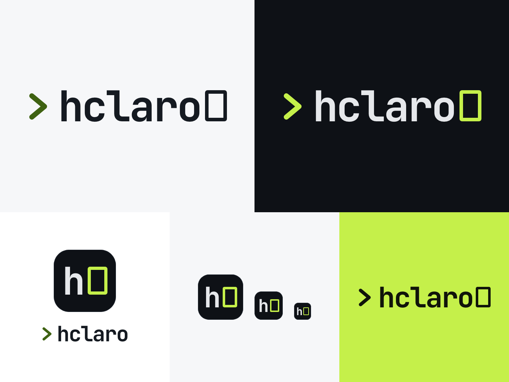

# Hclaro brand: hollow cursor

The identity introduced in M19. It was implemented from a design mockup supplied for the project
(a reference artboard, not production code). The mockup itself is **not distributed** with this
repository; every value taken from it (colours, geometry, sizes) is recorded in this document and in
the code that uses it. Nothing from the mockup's preview runtime is part of the application
(`internal/ui/embed_test.go` checks the embedded bundle).



`screenshots/brand-sheet.png` is rendered from the **built** stylesheet in `internal/ui/dist` by
`node scripts/brand-sheet.mjs` (run after `npm --prefix web run build`).

## 1. Source palette (exact)

Graphite + lime, from the redesign (`HCLARO_REDESIGN.md` §5, task A1); it replaced the M19 navy/ivory
palette. The palette is still provisional (redesign Q4): a later palette swap edits only
`web/src/styles/tokens.css`. These values exist once, as raw tokens at the top of that file; every
other colour is listed in §2.

| Raw token | Hex | Role |
|---|---|---|
| `--brand-graphite` | `#0E1116` | Dark background, app-icon tile |
| `--brand-paper` | `#F6F7F9` | Light background, light wordmark background |
| `--brand-ink` | `#151A21` | Light-theme text, light wordmark letters and cursor |
| `--brand-letter` | `#E6E8EB` | Dark-theme text, dark wordmark and mark letters |
| `--brand-lime` | `#C5F04A` | Accent, primary button fill (both themes), hollow cursor, inverse logo surface |
| `--brand-olive` | `#3F6212` | Light-theme chevron, accent graphics and accent text |
| `--brand-on-lime` | `#10140A` | Text on lime (primary buttons, inverse wordmark) |
| `--brand-edge` | `#2A323D` | Hairline edge of the app-icon tile |

## 2. Semantic tokens

Components use only semantic tokens. Each is declared once as `light-dark(<light>, <dark>)`:
`:root { color-scheme: light dark }` follows the operating system before any script runs, so a
system-theme user never sees the wrong palette flash; `data-theme="light|dark"` (set from the saved
preference before React renders, see `web/src/brand/theme.ts`) pins one. Lightning CSS compiles
`light-dark()` into a custom-property fallback, so it also works in browsers without native support.

The existing names (`--bg`, `--text`, …) were kept as the project convention; the redesign spec's
names map as: `--bar` = `--sidebar`, `--surface-2` = `--inset`, `--line` = `--border-soft`,
`--text-mid` = `--muted`, `--text-muted` = `--subtle`, `--accent-soft` = `--accent-dim`,
`--on-accent` = `--primary-foreground`, delete = `--destroy`.

| Token | Light | Dark | Notes |
|---|---|---|---|
| `--bg` | `--brand-paper` | `--brand-graphite` | content background |
| `--sidebar` | `#FFFFFF` | `#0B0E12` | sidebar and top bar |
| `--surface` | `#FFFFFF` | `#141920` | inputs, cards |
| `--surface-hover` | `#EBEEF2` | `#1A2029` | hover |
| `--surface-selected` | = `--accent-dim` | = `--accent-dim` | selected row/item |
| `--inset` | `#F1F3F6` | `#12161C` | group rows, panels |
| `--border` / `--border-soft` | `#D5DAE1` / `#E6E9EE` | `#232A33` / `#1A1F26` | dividers |
| `--input` | `#7A8491` | `#66717F` | form-control boundary (3:1) |
| `--text` | `--brand-ink` | `--brand-letter` | |
| `--muted` / `--subtle` | `#3C4552` / `#5B6675` | `#B4BCC6` / `#8B949E` | secondary text |
| `--accent` | `--brand-olive` | `--brand-lime` | graphics only |
| `--accent-dim` | `#EEF7D4` | `#1A2110` | active navigation background |
| `--accent-text` | `--brand-olive` | `--brand-lime` | accent as text |
| `--accent-foreground` | `--brand-on-lime` | `--brand-on-lime` | |
| `--primary` | `--brand-lime` | `--brand-lime` | primary button fill |
| `--primary-hover` | `#B6E234` | `#D4F574` | |
| `--primary-foreground` | `--brand-on-lime` | `--brand-on-lime` | |
| `--ring` | `--brand-olive` | `--brand-lime` | focus ring |
| `--logo-text` / `--logo-chevron` / `--logo-cursor` | ink / olive / ink | letter / lime / lime | |

Fixed semantic colours (the same for every palette; text on a tinted background):

| Meaning | Text light | Text dark | Tint light | Tint dark |
|---|---|---|---|---|
| create (`--create`, `--create-bg`) | `#2F6B1A` | `#9BE37A` | `#E6F4DF` | `#13240F` |
| update / warning (`--update`, `--update-bg`; `--warn` = `--update`) | `#8A6100` | `#F2CC60` | `#FBF1D4` | `#2A2410` |
| replace (`--replace`, `--replace-bg`) | `#A6460C` | `#F0A35E` | `#FCEADC` | `#2D1C10` |
| delete / error (`--destroy`, `--destroy-bg`) | `#B42318` | `#F08A7E` | `#FDE8E6` | `#2E1515` |
| read / data sources (`--read`) | `#4338CA` | `#A5B4FC` | — | — |
| status OK dot (`--ok`) | `#15803D` | `#6EE7A0` | — | — |
| destructive button (`--destructive-foreground` on `--destructive`) | `#FFFFFF` on `#B42318` | `#2A0F0B` on `#F4A196` | — | — |

Rules:

- **Graphite and paper dominate; lime is an accent.** Lime appears on the active-navigation marker,
  selected borders, focus rings, progress bars and primary buttons. It is never a large surface under body text.
- **Primary actions** are lime with near-black text in both themes. In light mode lime is only a fill:
  lime on white is 1.2:1, so accent graphics, rings and accent text use olive instead.
- **Statuses are not brand colours.** Create/update/replace/delete keep their own green, amber, orange
  and red, distinct from lime and olive (asserted by `web/src/brand/Brand.test.tsx`). Plan actions always pair
  colour with an icon and a word (`web/src/plans/labels.ts`: Create +, Update ✎, Replace ↻, Delete −,
  Read, Forget, Unknown ?, No change =), so meaning never depends on hue.
- **No raw hex outside `tokens.css`.** Shadows and the dialog scrim are tokens too (`--shadow`,
  `--shadow-sm`, `--scrim`); the brand test fails if any other stylesheet or `theme.ts` contains a hex
  value. `<meta name="theme-color">` cannot read CSS variables, so `web/index.html` says
  `__brand-paper__` / `__brand-graphite__` and the `brand-colours` Vite plugin fills them from
  `tokens.css` (dev and build); `theme.ts` reads the colours back from those meta tags.

## 3. Contrast results

WCAG 2.2 relative-luminance ratios, computed from the values above (the same calculation runs in
`web/src/brand/Brand.test.tsx`, which fails below the thresholds).

Text tokens (AA normal text, 4.5:1):

| Token | Theme | bg | sidebar | surface | surface-hover | surface-selected | inset |
|---|---|--:|--:|--:|--:|--:|--:|
| `--text` | light | 16.30 | 17.48 | 17.48 | 15.02 | 15.72 | 15.72 |
| `--text` | dark | 15.41 | 15.76 | 14.38 | 13.34 | 13.48 | 14.78 |
| `--muted` | light | 9.05 | 9.70 | 9.70 | 8.33 | 8.72 | 8.72 |
| `--muted` | dark | 9.86 | 10.08 | 9.20 | 8.54 | 8.63 | 9.46 |
| `--subtle` | light | 5.44 | 5.83 | 5.83 | 5.01 | 5.24 | 5.24 |
| `--subtle` | dark | 6.15 | 6.29 | 5.74 | 5.32 | 5.38 | 5.90 |
| `--accent-text` | light | 6.60 | 7.08 | 7.08 | 6.08 | 6.37 | 6.37 |
| `--accent-text` | dark | 14.35 | 14.68 | 13.40 | 12.43 | 12.56 | 13.77 |
| `--read` | light | 7.37 | 7.90 | 7.90 | 6.79 | 7.11 | 7.11 |
| `--read` | dark | 9.49 | 9.70 | 8.85 | 8.21 | 8.30 | 9.10 |
| `--create` | light | 6.05 | 6.48 | 6.48 | 5.57 | 5.83 | 5.83 |
| `--create` | dark | 12.30 | 12.58 | 11.48 | 10.65 | 10.77 | 11.81 |
| `--update` | light | 5.17 | 5.54 | 5.54 | 4.76 | 4.98 | 4.98 |
| `--update` | dark | 12.23 | 12.51 | 11.42 | 10.59 | 10.70 | 11.74 |
| `--replace` | light | 5.59 | 6.00 | 6.00 | 5.15 | 5.39 | 5.39 |
| `--replace` | dark | 9.10 | 9.31 | 8.49 | 7.88 | 7.96 | 8.73 |
| `--destroy` | light | 6.13 | 6.57 | 6.57 | 5.65 | 5.91 | 5.91 |
| `--destroy` | dark | 7.78 | 7.96 | 7.26 | 6.74 | 6.81 | 7.47 |

Non-text UI (focus indicators, accents, form-control boundaries, status dots, 3:1):

| Token | Theme | bg | sidebar | surface | surface-hover | surface-selected | inset |
|---|---|--:|--:|--:|--:|--:|--:|
| `--accent` | light | 6.60 | 7.08 | 7.08 | 6.08 | 6.37 | 6.37 |
| `--accent` | dark | 14.35 | 14.68 | 13.40 | 12.43 | 12.56 | 13.77 |
| `--ring` | light | 6.60 | 7.08 | 7.08 | 6.08 | 6.37 | 6.37 |
| `--ring` | dark | 14.35 | 14.68 | 13.40 | 12.43 | 12.56 | 13.77 |
| `--input` | light | 3.54 | 3.79 | 3.79 | 3.26 | 3.41 | 3.41 |
| `--input` | dark | 3.81 | 3.90 | 3.56 | 3.30 | 3.34 | 3.66 |
| `--ok` | light | 4.68 | 5.02 | 5.02 | 4.31 | 4.51 | 4.51 |
| `--ok` | dark | 12.25 | 12.53 | 11.43 | 10.60 | 10.72 | 11.75 |

Pairs on filled controls and tints (4.5:1):

| Pair | Light | Dark |
|---|--:|--:|
| `--primary-foreground` on `--primary` | 14.15 | 14.15 |
| `--primary-foreground` on `--primary-hover` | 12.35 | 15.19 |
| `--destructive-foreground` on `--destructive` | 6.57 | 8.86 |
| `--accent-text` on `--accent-dim` | 6.37 | 12.56 |
| `--create` on `--create-bg` | 5.67 | 10.62 |
| `--update` on `--update-bg` | 4.92 | 10.00 |
| `--replace` on `--replace-bg` | 5.12 | 7.86 |
| `--destroy` on `--destroy-bg` | 5.59 | 7.00 |

Logo variants (decorative logotype; recorded, not required to pass):

| Pair | Ratio |
|---|--:|
| Ink wordmark on paper / letter wordmark on graphite | 16.30 / 15.41 |
| Olive chevron on paper (light variant) | 6.60 |
| Lime chevron and cursor on graphite (dark variant, app icon) | 14.35 |
| On-lime wordmark, chevron and cursor on lime (inverse variant) | 14.15 |

Borders `--border`/`--border-soft` are decorative separators (about 1.3:1); they
never carry meaning on their own. Form controls use `--input` instead.

## 4. Logo anatomy

All dimensions are in `em` of the logo's font size, so every size keeps the reference proportions.

| Part | Geometry |
|---|---|
| Typeface | JetBrains Mono, weight 700, `letter-spacing: -0.04em`, `line-height: 1` |
| Chevron | SVG `viewBox="0 0 10 14"`, `<polyline points="2,2 8,7 2,12">`, `fill="none"`, `stroke-width="2.4"`, round caps and joins; drawn at `0.5em × 0.7em`, `margin-right: 0.22em`, baseline aligned |
| Word | lowercase `hclaro` |
| Hollow cursor | `0.52em × 0.73em`, `border: 0.09em solid`, `border-radius: 0.06em`, `margin-left: 0.1em`, border-box; unfilled and static (no blink) |

The chevron is vector geometry, never a `>` character, and the cursor is a border, never a filled
block. Its height (0.73em) equals the cap/ascender height of the typeface, so it aligns with the `h`
and `l`.

### Variants

| Variant | Background | Wordmark | Chevron | Cursor |
|---|---|---|---|---|
| Light | `#F6F7F9` | `#151A21` | `#3F6212` | `#151A21` |
| Dark | `#0E1116` | `#E6E8EB` | `#C5F04A` | `#C5F04A` |
| Inverse (lime) | `#C5F04A` | `#10140A` | `#10140A` | `#10140A` |

The reference also shows a secondary lockup without the cursor (`30px`, under the app icon), available
as `<HclaroLogo cursor={false} />`.

### App icon / compact mark

From 32 px up: the lime chevron, lowercase `#E6E8EB` `h` and the lime hollow cursor (`>h▯`) on a graphite rounded square with a `#2A323D` hairline edge (the favicons have no edge). The 24 px mark and the 16 px favicon keep `h▯`, without the chevron: at those sizes it would be a few pixels and the `h` would become hard to read. Sizes:

| Tile | Radius | Letter size |
|---|---|---|
| 88 px | 22 px | 34 px |
| 64 px | 16 px | 25 px |
| 40 px | 10 px | 16 px |
| 24 px | 6 px | 15 px (no chevron) |

Radius is always a quarter of the tile; with the chevron the letters are about 0.39 of the tile (0.625 at 24 px, where there is no chevron), so the wider `>h▯` glyph keeps the share of the tile that `h▯` had. `favicon.svg` stays `h▯` because tabs scale it down to 16 px; `favicon-32.png`, the touch icon and the docs icons use `>h▯`.

**Small sizes.** At 24 px the cursor border is 1.35 px and stays hollow (checked in the browser at 1×
and 2×). At 16 px the reference proportions give a 0.9 px border that blurs into a filled block, so the
16 px favicon PNG is pixel-snapped: same shapes, 1 px ring, 3 × 6 px hollow, `h` on pixel rows 4–12.
At 32 px and above the exact proportions are used. The wordmark is not used below about 18 px; the
collapsed sidebar (≤ 900 px wide) switches to the 40 px mark.

## 5. Components

`web/src/brand/HclaroLogo.tsx`:

```tsx
<HclaroLogo />                          // theme-following wordmark, role="img" name "Hclaro"
<HclaroLogo variant="inverse" size={40} />
<HclaroLogo decorative />               // inside a control that already has a name
<HclaroLogo cursor={false} />           // secondary lockup
<HclaroMark size={40} />                // 88 | 64 | 40 | 24
```

- `variant`: `auto` (default, follows the theme through `--logo-*` tokens), `light`, `dark`,
  `inverse` (pinned to the literal reference colours whatever the theme).
- Accessibility: one accessible name (`label`, default "Hclaro") on a `role="img"` wrapper; the
  visible lowercase text, chevron and cursor are `aria-hidden`, so screen readers say "Hclaro" once.
  With `decorative` the whole logo is hidden, as in the sidebar link named "Hclaro overview".

Where it is used:

| Place | Component |
|---|---|
| Sidebar, expanded | `HclaroLogo` (auto), 23 px, 19 px at ≤ 1350 px wide |
| Sidebar, collapsed (≤ 900 px) | `HclaroMark` 40 px with a hairline edge on the dark sidebar |
| Loading (before the bundle runs) | static mark in `web/index.html` (`.boot-splash`, 64 px; no inline styles, as the CSP forbids them) |
| Workspace Hub first-run state | `HclaroMark` 40 px |
| Settings → About Hclaro | `HclaroLogo` (auto), 24 px |
| Browser tab | `favicon.svg`, `favicon-32.png`, `favicon-16.png`, `apple-touch-icon.png`; `<meta name="theme-color">` paper/graphite |

The repository has no marketing site, Storybook or web manifest. The local server's CSP is
`default-src 'none'` with no `manifest-src`, so a manifest would be blocked; the 192/512 px app icons
are kept in `assets/` for packagers instead of being shipped in the UI.

## 6. Typography

- **Logo:** JetBrains Mono Bold, self-hosted from `@fontsource/jetbrains-mono` (SIL Open Font License
  1.1, listed in `THIRD-PARTY-NOTICES.txt`). Only the Latin 700 subset (22 kB woff2 plus a
  woff fallback) is bundled for the logo. They are served from the binary under `font-src 'self'`; Vite's `assetsInlineLimit: 0`
  keeps fonts out of `data:` URIs, which the CSP would block. No Google Fonts or other network request.
  If the font fails, the logo falls back to `ui-monospace, SFMono-Regular, Menlo, Consolas, monospace`
  with the same geometry.
- **Interface:** DM Sans (variable, `@fontsource-variable/dm-sans`, SIL OFL 1.1, listed in `THIRD-PARTY-NOTICES.txt`), self-hosted the same way, 13 px base (`:root` font-size). All subsets are bundled; `unicode-range` makes the browser load only the ones a page needs, normally Latin.
- **Code, addresses, types, versions and paths:** DM Mono (`@fontsource/dm-mono`, SIL OFL 1.1; Latin 400 and 500 bundled, there is no bold, and `font-synthesis: none` keeps the browser from faking one, so monospace text uses weight 400 or 500) through the `--font-mono` token ( Tailwind's `font-mono` reads the same variable), falling back to `ui-monospace, SFMono-Regular, Menlo, Consolas, monospace`.

## 7. Assets

Generated by `make brand-assets` (`scripts/brand-assets.mjs`) and committed. Glyphs are converted to
vector paths (outlines of JetBrains Mono Bold, extracted with fontTools), so icons render identically
without the font. PNGs are rendered offline by the Playwright Chromium already used for tests.

| File | Use |
|---|---|
| `web/public/favicon.svg` | Browser tab (vector) |
| `web/public/favicon-16.png`, `favicon-32.png` | Raster favicons (16 px pixel-snapped) |
| `web/public/apple-touch-icon.png` | 180 px touch icon |
| `docs/design/assets/hclaro-mark.svg`, `hclaro-mark-light.svg` | Mark source (graphite, and paper for light backgrounds), with tile edge |
| `docs/design/assets/hclaro-wordmark-{light,dark,inverse}.svg` | Wordmarks on their reference backgrounds |
| `docs/design/assets/hclaro-wordmark-{light,dark}-transparent.svg` | Wordmarks without a background |
| `docs/design/assets/hclaro-icon-{192,512,1024}.png`, `hclaro-icon-light-{192,512,1024}.png` | App icons for packagers |
| `docs/design/assets/hclaro-wordmark-*@2x.png` | 1200 px wordmarks for the README and social previews |

The previous three-bar CSS mark and the green `H` favicon (`#a3e8bc`/`#14211b`) are removed; nothing
else referenced them.

## 8. Screenshots

`screenshots/brand-sheet.png` is the only committed design screenshot. Plan, apply, import, replace,
drift, discovery and cost screens are captured in dark mode by `make browser-test` in
`.cache/screenshots/` (not committed).
