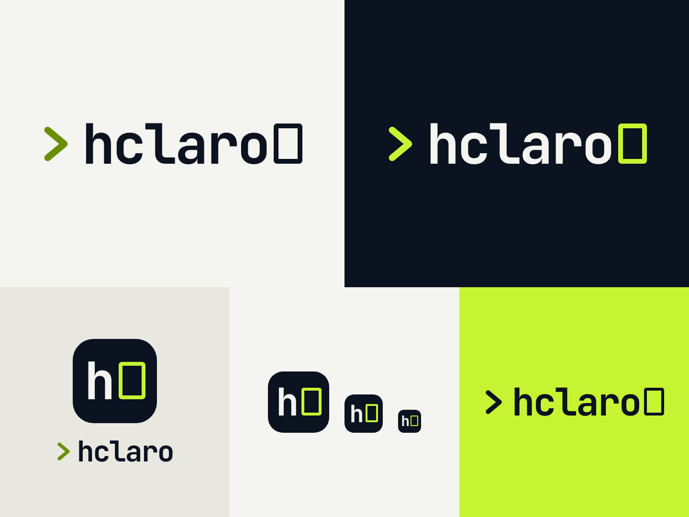

# Hclaro brand: hollow cursor

The identity introduced in M19. It was implemented from a design mockup supplied for the project
(a reference artboard, not production code). The mockup itself is **not distributed** with this
repository; every value taken from it (colours, geometry, sizes) is recorded in this document and in
the code that uses it. Nothing from the mockup's preview runtime is part of the application
(`internal/ui/embed_test.go` checks the embedded bundle).



`screenshots/brand-sheet.png` is rendered from the **built** stylesheet in `internal/ui/dist`; against
the reference artboard rendered with the same font it differs in 0.47 % of pixels (anti-aliasing).

## 1. Source palette (exact)

These five values are copied literally from the reference. They exist once, as raw tokens at the
top of `web/src/styles/tokens.css`, and are never edited or approximated; every other colour is derived and
listed separately in §2.

| Raw token | Hex | Role |
|---|---|---|
| `--brand-navy` | `#0B1220` | Dark background, light-theme text, app-icon tile |
| `--brand-ivory` | `#F4F4F0` | Light background, dark-theme text and wordmark |
| `--brand-stone` | `#E8E8E1` | Secondary light surface (light sidebar), icon presentation |
| `--brand-lime` | `#C6F432` | Dark-theme accent, hollow cursor, inverse logo surface |
| `--brand-olive` | `#6A8F00` | Light-theme chevron and accent graphics |

## 2. Semantic tokens

Components use only semantic tokens. Each is declared once as `light-dark(<light>, <dark>)`:
`:root { color-scheme: light dark }` follows the operating system before any script runs, so a
system-theme user never sees the wrong palette flash; `data-theme="light|dark"` (set from the saved
preference before React renders, see `web/src/brand/theme.ts`) pins one. Lightning CSS compiles
`light-dark()` into a custom-property fallback, so it also works in browsers without native support.

The existing names (`--bg`, `--text`, …) were kept as the project convention. Mapping to the usual
shadcn/ui vocabulary is given in the last column.

| Token | Light | Dark | Derived? | shadcn name |
|---|---|---|---|---|
| `--bg` | `--brand-ivory` | `--brand-navy` | no | background |
| `--sidebar` | `--brand-stone` | `#0E1626` | dark derived | sidebar |
| `--surface` | `#FBFBF8` | `#131C2D` | derived | card / popover |
| `--surface-hover` | `#EDEDE6` | `#1A2437` | derived | accent (hover) |
| `--surface-selected` | `#E6EDCF` | `#1E2B25` | derived (olive/lime tint) | — |
| `--inset` | `#EFEFE9` | `#0D1524` | derived | muted |
| `--border` / `--border-soft` | `#D6D6CD` / `#E3E3DB` | `#253047` / `#1A2436` | derived | border |
| `--input` | `#7E837A` | `#66728A` | derived (3:1 boundary) | input |
| `--text` | `--brand-navy` | `--brand-ivory` | no | foreground |
| `--muted` / `--subtle` | `#4B5363` / `#5D6573` | `#A4ACB9` / `#8891A0` | derived | muted-foreground |
| `--accent` | `--brand-olive` | `--brand-lime` | no | — (brand accent, graphics only) |
| `--accent-dim` | `#DDE8B8` | `#2D3B23` | derived | — |
| `--accent-text` | `#4A6600` | `--brand-lime` | light derived | — (accent as text) |
| `--accent-foreground` | `--brand-navy` | `--brand-navy` | no | accent-foreground |
| `--primary` | `--brand-navy` | `--brand-lime` | no | primary |
| `--primary-hover` | `#1E2A3F` | `#D4F75E` | derived | — |
| `--primary-foreground` | `--brand-ivory` | `--brand-navy` | no | primary-foreground |
| `--ring` | `#4A6600` | `--brand-lime` | light derived | ring |
| `--purple` (data sources) | `#6650A8` | `#B3A5E5` | derived | — |
| `--create` | `#1E6E3A` | `#8FDCAB` | derived | — |
| `--update` | `#7F5400` | `#E3C27A` | derived | — |
| `--destroy` | `#AE3326` | `#F09A8F` | derived | destructive |
| `--warn` | `#835200` | `#E7B86A` | derived | — |
| `--logo-text` / `--logo-chevron` / `--logo-cursor` | navy / olive / navy | ivory / lime / lime | no | — |

Rules:

- **Navy, ivory and stone dominate; lime is an accent.** Lime appears on the active-navigation
  marker, selected borders, focus rings, progress bars and the primary button in dark mode. It is
  never a large surface under body text.
- **Primary actions** are navy with ivory text in light mode and lime with navy text in dark mode.
  Lime on ivory would be readable text but an invisible button edge (1.16:1), so it is not used.
- **The light-mode olive is not a text colour.** `#6A8F00` on `#F4F4F0` is 3.44:1, enough for the
  chevron and other graphics (3:1) but not for small text. Text in the accent hue uses the derived
  `--accent-text` `#4A6600` (≥ 5.35:1 on every light surface). The logo's chevron keeps the reference
  olive unchanged.
- **Statuses are not brand colours.** Create/update/destroy/warn keep their own green, amber and red,
  distinct from lime and olive (asserted by `web/src/brand/Brand.test.tsx`). Plan actions always pair
  colour with an icon and a word (`web/src/plans/labels.ts`: Create +, Update ✎, Replace ↻, Delete −,
  Read, Forget, Unknown ?, No change =), so meaning never depends on hue. The light values were darkened to pass 4.5:1 on the new surfaces.
- Remaining literal colours outside the token block are only transparent/black shadows and the dialog
  scrim (`#000`, `#0000`, `#0001`, `#0008`); the brand test fails if any other hex appears.

## 3. Contrast results

WCAG 2.2 relative-luminance ratios, computed from the values above (the same calculation runs in
`web/src/brand/Brand.test.tsx`, which fails below the thresholds).

Text tokens (AA normal text, 4.5:1):

| Token | Theme | bg | sidebar | surface | surface-hover | surface-selected | inset |
|---|---|--:|--:|--:|--:|--:|--:|
| `--text` | light | 16.98 | 15.21 | 18.06 | 15.92 | 15.49 | 16.22 |
| `--text` | dark | 16.98 | 16.40 | 15.46 | 14.09 | 13.34 | 16.56 |
| `--muted` | light | 7.01 | 6.28 | 7.46 | 6.57 | 6.40 | 6.70 |
| `--muted` | dark | 8.18 | 7.90 | 7.45 | 6.79 | 6.43 | 7.98 |
| `--subtle` | light | 5.33 | 4.77 | 5.67 | 5.00 | 4.86 | 5.09 |
| `--subtle` | dark | 5.89 | 5.69 | 5.36 | 4.89 | 4.63 | 5.74 |
| `--accent-text` | light | 5.97 | 5.35 | 6.35 | 5.59 | 5.45 | 5.70 |
| `--accent-text` | dark | 14.61 | 14.11 | 13.30 | 12.13 | 11.48 | 14.25 |
| `--purple` | light | 5.81 | 5.20 | 6.18 | 5.45 | 5.30 | 5.55 |
| `--purple` | dark | 8.41 | 8.12 | 7.66 | 6.98 | 6.61 | 8.20 |
| `--create` | light | 5.69 | 5.10 | 6.05 | 5.34 | 5.19 | 5.44 |
| `--create` | dark | 11.58 | 11.19 | 10.55 | 9.61 | 9.10 | 11.30 |
| `--update` | light | 6.01 | 5.38 | 6.39 | 5.63 | 5.48 | 5.74 |
| `--update` | dark | 10.93 | 10.56 | 9.96 | 9.07 | 8.59 | 10.67 |
| `--destroy` | light | 5.77 | 5.17 | 6.14 | 5.41 | 5.26 | 5.51 |
| `--destroy` | dark | 8.67 | 8.37 | 7.89 | 7.20 | 6.81 | 8.46 |
| `--warn` | light | 6.00 | 5.38 | 6.39 | 5.63 | 5.48 | 5.74 |
| `--warn` | dark | 10.22 | 9.87 | 9.31 | 8.48 | 8.03 | 9.97 |

Non-text UI (focus indicators, accents, form-control boundaries, 3:1):

| Token | Theme | bg | sidebar | surface | surface-hover | surface-selected | inset |
|---|---|--:|--:|--:|--:|--:|--:|
| `--accent` | light | 3.44 | 3.08 | 3.66 | 3.22 | 3.14 | 3.28 |
| `--accent` | dark | 14.61 | 14.11 | 13.30 | 12.13 | 11.48 | 14.25 |
| `--ring` | light | 5.97 | 5.35 | 6.35 | 5.59 | 5.45 | 5.70 |
| `--ring` | dark | 14.61 | 14.11 | 13.30 | 12.13 | 11.48 | 14.25 |
| `--input` | light | 3.52 | 3.15 | 3.74 | 3.30 | 3.21 | 3.36 |
| `--input` | dark | 3.87 | 3.74 | 3.52 | 3.21 | 3.04 | 3.77 |

Pairs on filled controls:

| Pair | Light | Dark |
|---|--:|--:|
| `--primary-foreground` on `--primary` | 16.98 | 14.61 |
| `--primary-foreground` on `--primary-hover` | 13.06 | 15.39 |
| `--surface` (label) on `--destroy` (destructive button) | 6.14 | 7.89 |
| `--accent-text` on `--accent-dim` (completed wizard step) | 5.11 | 9.30 |

Logo variants (decorative logotype; recorded, not required to pass):

| Pair | Ratio |
|---|--:|
| Navy wordmark on ivory / ivory wordmark on navy | 16.98 |
| Olive chevron on ivory (light variant) | 3.44 |
| Lime chevron and cursor on navy (dark variant, app icon) | 14.61 |
| Navy wordmark, chevron and cursor on lime (inverse variant) | 14.61 |

Borders `--border`/`--border-soft` are decorative separators (about 1.4–1.5:1, as before M19); they
never carry meaning on their own. Form controls use `--input` instead.

## 4. Logo anatomy

All dimensions are in `em` of the logo's font size, so every size keeps the reference proportions.

| Part | Geometry |
|---|---|
| Typeface | JetBrains Mono, weight 700, `letter-spacing: -0.04em`, `line-height: 1` |
| Chevron | SVG `viewBox="0 0 10 14"`, `<polyline points="2,2 8,7 2,12">`, `fill="none"`, `stroke-width="2.4"`, round caps and joins; drawn at `0.5em × 0.7em`, `margin-right: 0.22em`, baseline aligned |
| Word | lowercase `hclaro` |
| Hollow cursor | `0.52em × 0.73em`, `border: 0.09em solid`, `border-radius: 0.06em`, `margin-left: 0.1em`, border-box; unfilled and static (no blink) |

The chevron is vector geometry, never a `>` character, and the cursor is a border, never a filled
block. Its height (0.73em) equals the cap/ascender height of the typeface, so it aligns with the `h`
and `l`.

### Variants

| Variant | Background | Wordmark | Chevron | Cursor |
|---|---|---|---|---|
| Light | `#F4F4F0` | `#0B1220` | `#6A8F00` | `#0B1220` |
| Dark | `#0B1220` | `#F4F4F0` | `#C6F432` | `#C6F432` |
| Inverse (lime) | `#C6F432` | `#0B1220` | `#0B1220` | `#0B1220` |

The reference also shows a secondary lockup without the cursor (`30px`, under the app icon), available
as `<HclaroLogo cursor={false} />`.

### App icon / compact mark

Lowercase ivory `h` plus the lime hollow cursor on a navy rounded square. Reference sizes:

| Tile | Radius | Letter size |
|---|---|---|
| 88 px | 22 px | 54 px |
| 64 px | 16 px | 40 px |
| 40 px | 10 px | 25 px |
| 24 px | 6 px | 15 px |

Radius is always a quarter of the tile; the letter is 0.625 of the tile (0.614 at 88 px in the reference).

**Small sizes.** At 24 px the cursor border is 1.35 px and stays hollow (checked in the browser at 1×
and 2×). At 16 px the reference proportions give a 0.9 px border that blurs into a filled block, so the
16 px favicon PNG is pixel-snapped: same shapes, 1 px ring, 3 × 6 px hollow, `h` on pixel rows 4–12.
At 32 px and above the exact proportions are used. The wordmark is not used below about 18 px; the
collapsed sidebar (≤ 900 px wide) switches to the 40 px mark.

## 5. Components

`web/src/brand/HclaroLogo.tsx`:

```tsx
<HclaroLogo />                          // theme-following wordmark, role="img" name "Hclaro"
<HclaroLogo variant="inverse" size={40} />
<HclaroLogo decorative />               // inside a control that already has a name
<HclaroLogo cursor={false} />           // secondary lockup
<HclaroMark size={40} />                // 88 | 64 | 40 | 24
```

- `variant`: `auto` (default, follows the theme through `--logo-*` tokens), `light`, `dark`,
  `inverse` (pinned to the literal reference colours whatever the theme).
- Accessibility: one accessible name (`label`, default "Hclaro") on a `role="img"` wrapper; the
  visible lowercase text, chevron and cursor are `aria-hidden`, so screen readers say "Hclaro" once.
  With `decorative` the whole logo is hidden, as in the sidebar link named "Hclaro overview".

Where it is used:

| Place | Component |
|---|---|
| Sidebar, expanded | `HclaroLogo` (auto), 23 px, 19 px at ≤ 1350 px wide |
| Sidebar, collapsed (≤ 900 px) | `HclaroMark` 40 px with a hairline edge on the dark sidebar |
| Loading (before the bundle runs) | static mark in `web/index.html` (`.boot-splash`, 64 px; no inline styles, as the CSP forbids them) |
| Workspace Hub first-run state | `HclaroMark` 40 px |
| Settings → About Hclaro | `HclaroLogo` (auto), 24 px |
| Browser tab | `favicon.svg`, `favicon-32.png`, `favicon-16.png`, `apple-touch-icon.png`; `<meta name="theme-color">` ivory/navy |

The repository has no marketing site, Storybook or web manifest. The local server's CSP is
`default-src 'none'` with no `manifest-src`, so a manifest would be blocked; the 192/512 px app icons
are kept in `assets/` for packagers instead of being shipped in the UI.

## 6. Typography

- **Logo:** JetBrains Mono Bold, self-hosted from `@fontsource/jetbrains-mono` (SIL Open Font License
  1.1, listed in `THIRD-PARTY-NOTICES.txt`). Only the Latin 700 subset is bundled (22 kB woff2 plus a
  woff fallback). It is served from the binary under `font-src 'self'`; Vite's `assetsInlineLimit: 0`
  keeps fonts out of `data:` URIs, which the CSP would block. No Google Fonts or other network request.
  If the font fails, the logo falls back to `ui-monospace, SFMono-Regular, Menlo, Consolas, monospace`
  with the same geometry.
- **Interface:** unchanged (Inter/system UI stack; SFMono/Consolas for code and addresses).

## 7. Assets

Generated by `make brand-assets` (`scripts/brand-assets.mjs`) and committed. Glyphs are converted to
vector paths (outlines of JetBrains Mono Bold, extracted with fontTools), so icons render identically
without the font. PNGs are rendered offline by the Playwright Chromium already used for tests.

| File | Use |
|---|---|
| `web/public/favicon.svg` | Browser tab (vector) |
| `web/public/favicon-16.png`, `favicon-32.png` | Raster favicons (16 px pixel-snapped) |
| `web/public/apple-touch-icon.png` | 180 px touch icon |
| `docs/design/assets/hclaro-mark.svg` | Mark source |
| `docs/design/assets/hclaro-wordmark-{light,dark,inverse}.svg` | Wordmarks on their reference backgrounds |
| `docs/design/assets/hclaro-icon-{192,512}.png` | App icons for packagers |

The previous three-bar CSS mark and the green `H` favicon (`#a3e8bc`/`#14211b`) are removed; nothing
else referenced them.

## 8. Screenshots

Captured in both themes from `make demo-hub` (synthetic projects, fake engine, all non-local requests
blocked) at 1440 × 900 with reduced motion, and the collapsed sidebar at 860 px:
`screenshots/{hub,hub-project,overview,resources,settings,collapsed-sidebar}-{light,dark}.png`.
Plan, apply, import, replace, drift, discovery and cost screens are captured in dark mode by
`make browser-test` in `docs/screenshots/`.
